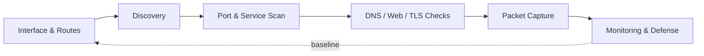

<div align="center">

# 🛡️ Advanced Networking & Cybersecurity Toolkit

**A practical field reference for recon, packet analysis, wireless auditing, web testing, monitoring, and defense.**


</div>

> [!WARNING]
> **Scope:** Use these tools only on systems, wireless networks, and lab environments you **own** or have **explicit written permission** to assess. Commands and output vary by distribution and tool version.

---

## 🧭 The Big Picture

Good assessments go layer by layer. Never assume a failure is "the network" until you've checked each step.



## 📚 Table of Contents

| # | Section | What you'll do |
|---|---------|----------------|
| 1 | [Interface & Configuration](#1--network-interface-and-configuration) | Know your own network first |
| 2 | [Discovery & Recon](#2--network-discovery-and-reconnaissance) | Find hosts and routes |
| 3 | [Nmap Deep Dive](#3--nmap-advanced-port-scanning) | Scan smart, not loud |
| 4 | [DNS & Domains](#4--dns-and-domain-enumeration) | Read what DNS reveals |
| 5 | [Packet Capture](#5--packet-capture-and-traffic-analysis) | See the wire |
| 6 | [Wireless Security](#6--wireless-security-aircrack-ng) | Audit your own Wi-Fi |
| 7 | [Burp Suite & APIs](#7--web-and-api-security-burp-suite) | Test web apps in a lab |
| 8 | [Web Content Discovery](#8--web-content-discovery) | Inventory paths and tech |
| 9 | [Connections & Troubleshooting](#9--network-connections-and-troubleshooting) | Diagnose layer by layer |
| 10 | [Monitoring & Defense](#10--network-traffic-monitoring-and-defense) | Zeek, Suricata, Snort |
| 11 | [TLS & Certificates](#11--tls-and-certificate-analysis) | Check crypto hygiene |
| 12 | [VPNs & Remote Access](#12--vpns-and-secure-remote-access) | OpenVPN and WireGuard |
| 13 | [Performance Testing](#13--network-performance-testing) | Measure throughput and latency |

---

## ⚡ Quick Cheat Sheet

| I want to... | Command |
|--------------|---------|
| See my IPs | `ip -br addr` |
| Find my gateway/route | `ip route get 1.1.1.1` |
| See listening ports | `sudo ss -lntup` |
| Find live hosts on LAN | `sudo arp-scan --localnet` |
| Scan a lab host | `nmap -sC -sV 192.168.1.10` |
| Look up DNS | `dig +short example.com` |
| Capture DNS traffic | `sudo tcpdump -i eth0 'port 53'` |
| Inspect a TLS cert | `openssl s_client -connect example.com:443 -servername example.com` |
| Trace a route | `mtr -rw example.com` |

---

## 1. 🔌 Network Interface and Configuration

Identify interfaces, IP addresses, routes, DNS settings, and active connections.

### `ip` — Interfaces and routing

```bash
ip addr
ip -br addr
```

```bash
ip route
ip route get 1.1.1.1
```

```bash
ip neigh
```

> 💡 **Why it matters:** Before scanning or troubleshooting, know your interface, local subnet, default gateway, and the route used to reach the destination.

### `nmcli` — NetworkManager CLI

```bash
nmcli device status
nmcli connection show
nmcli device show
```

### `ss` — Socket statistics

```bash
ss -lntup
```

```bash
ss -tn state established
```

```bash
sudo ss -lntup
```

🔒 **Security use:** Spot unexpected listening services and see which processes own which ports.

### `resolvectl` — DNS configuration

```bash
resolvectl status
```

Shows DNS servers and resolver settings on systems using `systemd-resolved`.

---

## 2. 🔍 Network Discovery and Reconnaissance

Recon identifies hosts, exposed services, and network structure within an authorized scope.

### `nmap` — The Network Mapper

Host discovery, port scanning, service detection, and basic OS fingerprinting.

Discover live hosts on a lab subnet:

```bash
nmap -sn 192.168.1.0/24
```

Scan selected TCP ports:

```bash
nmap -p 22,53,80,443,445 192.168.1.10
```

Detect service versions:

```bash
nmap -sV 192.168.1.10
```

Run default scripts plus version detection against a lab target:

```bash
nmap -sC -sV 192.168.1.10
```

Save results in all formats (`.nmap`, `.gnmap`, `.xml`):

```bash
nmap -sV -oA lab-scan 192.168.1.10
```

> [!IMPORTANT]
> Service detection and scripts generate traffic and interact with services. Stay within the approved scope.

### `arp-scan` — Local network discovery

```bash
sudo arp-scan --localnet
```

```bash
sudo arp-scan --interface=eth0 --localnet
```

ARP discovery works on local IPv4 Ethernet networks. It does not cross routers the way a subnet scan does.

### `netdiscover` — LAN discovery

```bash
sudo netdiscover
```

For a known lab subnet:

```bash
sudo netdiscover -r 192.168.1.0/24
```

Interface names and options depend on your environment.

### `traceroute` and `mtr` — Route analysis

```bash
traceroute example.com
```

```bash
mtr example.com
```

> 📝 Routers may block or deprioritize probe traffic, so missing responses don't automatically mean a broken connection.

---

## 3. 🎯 Nmap: Advanced Port Scanning

Choose the **least intrusive** scan that answers your question.

| Goal | Command |
|------|---------|
| Port range | `nmap -p 1-1000 192.168.1.10` |
| Top 100 common ports | `nmap --top-ports 100 192.168.1.10` |
| TCP SYN scan (needs root) | `sudo nmap -sS -p 1-1000 192.168.1.10` |
| UDP services | `sudo nmap -sU -p 53,67,123,161 192.168.1.10` |
| Known service | `nmap -sV -p 22 192.168.1.10` |

> ⏱️ UDP scanning is slow and ambiguous, since many services don't respond to probes.

### Using NSE scripts

List installed scripts:

```bash
ls /usr/share/nmap/scripts/
```

Search for scripts related to a service:

```bash
ls /usr/share/nmap/scripts/ | grep -i http
```

Run a script only after reading its documentation and confirming it suits the target.

### Reading port states

| State | Meaning |
|-------|---------|
| `open` | A service is accepting connections |
| `closed` | Host responded, nothing is listening |
| `filtered` | Filtering or missing responses prevent a determination |
| `open\|filtered` | Nmap can't tell whether it's open or filtered |

> 🧠 **Lesson:** An open port is not proof of a vulnerability. Identify the service, verify its configuration, and gather evidence.

---

## 4. 🌐 DNS and Domain Enumeration

DNS recon reveals name records, mail infrastructure, and domain configuration.

### `dig` — DNS queries

```bash
dig example.com A
dig example.com AAAA
dig example.com MX
dig example.com NS
```

Concise answer:

```bash
dig +short example.com
```

Query a specific resolver:

```bash
dig @1.1.1.1 example.com
```

### `host`, `nslookup`, `whois`

```bash
host example.com
```

```bash
nslookup example.com
```

```bash
whois example.com
```

WHOIS may show registrar, dates, and name servers. Privacy protection can limit what's visible.

### `dnsrecon`

```bash
dnsrecon -d example.com
```

Use only on domains within your authorized scope. Avoid uncontrolled enumeration or attempts to bypass DNS security restrictions.

### Email security checks (SPF, DKIM, DMARC)

```bash
dig example.com TXT
```

```bash
dig _dmarc.example.com TXT
```

DKIM lookups need the correct **selector**, usually found in the domain's email configuration.

> 🧠 **Lesson:** DNS records can expose misconfigurations, but a record existing doesn't prove a domain is secure.

---

## 5. 📡 Packet Capture and Traffic Analysis

### `tcpdump` — CLI capture

```bash
sudo tcpdump -D
```

```bash
sudo tcpdump -i eth0
```

DNS traffic only:

```bash
sudo tcpdump -i eth0 'port 53'
```

One lab host only:

```bash
sudo tcpdump -i eth0 'host 192.168.1.10'
```

Save to a file:

```bash
sudo tcpdump -i eth0 -w lab-traffic.pcap
```

Read it back:

```bash
tcpdump -r lab-traffic.pcap
```

Hex and ASCII contents:

```bash
sudo tcpdump -i eth0 -nn -X
```

> [!CAUTION]
> Captures can contain credentials, tokens, and private communications. Capture only what you need and protect the files.

### Wireshark — GUI analysis

**Typical workflow**

1. Select the correct capture interface
2. Start a capture in an authorized lab
3. Generate or observe the traffic of interest
4. Apply a display filter
5. Inspect packet details and protocol fields
6. Export a minimal, sanitized capture for documentation

**Handy display filters**

| Filter | Purpose |
|--------|---------|
| `dns` | DNS packets |
| `http` | HTTP traffic |
| `tls` | TLS protocol traffic |
| `tcp.port == 443` | TCP on port 443 |
| `ip.addr == 192.168.1.10` | Packets involving an IPv4 address |
| `tcp.flags.syn == 1 && tcp.flags.ack == 0` | Initial TCP SYN packets |
| `icmp` | ICMP packets |

> 🔑 **Capture filters** decide which packets are *collected*. **Display filters** decide which captured packets are *shown*.

### TShark — Wireshark's CLI

```bash
sudo tshark -i eth0
```

```bash
tshark -r lab-traffic.pcap
```

```bash
tshark -r lab-traffic.pcap -Y dns
```

Extract selected fields:

```bash
tshark -r lab-traffic.pcap -T fields -e frame.number -e ip.src -e ip.dst -e _ws.col.Protocol
```

Count packets by protocol:

```bash
tshark -r lab-traffic.pcap -q -z io,phs
```

Great for automating inspection and producing repeatable evidence.

---

## 6. 📶 Wireless Security: Aircrack-ng

Used for auditing **your own** wireless networks with compatible adapters.

Check interfaces:

```bash
iw dev
```

```bash
ip -br link
```

Check adapter capabilities (look for supported modes and channels):

```bash
iw list
```

> Monitor-mode support depends on the adapter, driver, and chipset.

Ordinary Wi-Fi discovery via NetworkManager:

```bash
nmcli device wifi list
```

### The suite at a glance

| Tool | Purpose |
|------|---------|
| `airmon-ng` | Manages monitor mode on supported adapters |
| `airodump-ng` | Captures and displays wireless traffic |
| `aireplay-ng` | Generates wireless test traffic (authorized lab only) |
| `aircrack-ng` | Audits supported wireless authentication captures |

```bash
aircrack-ng --help
```

Check interface and process state before changing wireless mode:

```bash
iw dev
```

```bash
sudo airmon-ng
```

For an authorized lab capture, `airodump-ng` can save packets to a file. Verify the file before analyzing it:

```bash
ls -lh *.cap
```

```bash
file scan.cap
```

<details>
<summary>🛠️ Troubleshooting checklist</summary>

- Confirm the capture filename and path
- Confirm the capture contains relevant packets
- Check adapter and driver support
- Verify the interface is in the expected mode
- Don't assume every capture contains a usable authentication exchange

</details>

> 🧠 **Lesson:** Audit your own router's configuration, encryption, firmware, and password strength. Never capture or interfere with other people's networks.

---

## 7. 🕷️ Web and API Security: Burp Suite

Burp Suite inspects HTTP(S) traffic, tests authentication, and analyzes APIs.

| Component | Purpose |
|-----------|---------|
| **Proxy** | Intercepts and inspects HTTP/S from a configured client |
| **Repeater** | Re-sends manually modified requests |
| **Intruder** | Automates request variations within an authorized scope |
| **Decoder** | Encodes and decodes common formats |
| **Comparer** | Diffs requests, responses, and data |
| **Logger / HTTP history** | Reviews recorded traffic (varies by edition) |

**Recommended lab workflow**

1. Start Burp Suite
2. Use a dedicated browser profile configured for Burp's proxy
3. Open a deliberately vulnerable app or authorized test API
4. Review requests and responses in Proxy history
5. Send an interesting request to Repeater
6. Change **one parameter at a time**
7. Compare status codes, headers, bodies, and timing
8. Record the finding and explain its security impact

### Poking an API with `curl`

```bash
curl -i https://example.com/api/
```

```bash
curl -i -X POST https://example.com/api/test \
  -H 'Content-Type: application/json' \
  -d '{"name":"test"}'
```

The endpoint is illustrative. Substitute one you're authorized to test.

### `mitmproxy`

```bash
mitmproxy --help
```

Offers CLI and web interfaces for examining HTTP traffic. Handle certificate trust carefully, especially with HTTPS.

> 🧠 **Focus on:** broken access control, authentication weaknesses, input validation, insecure data exposure, and incorrect API behavior. Never test real users' accounts or data without authorization.

---

## 8. 🗂️ Web Content Discovery

Inventory paths and technologies of an **authorized** web app.

**Gobuster**

```bash
gobuster dir --help
```

```bash
gobuster dir -u http://127.0.0.1:8000 -w /usr/share/wordlists/dirb/common.txt
```

**FFUF**

```bash
ffuf -h
```

```bash
ffuf -u http://127.0.0.1:8000/FUZZ -w /usr/share/wordlists/dirb/common.txt
```

**WhatWeb**

```bash
whatweb http://127.0.0.1:8000
```

**Nikto**

```bash
nikto -Help
```

Nikto checks for server issues and risky configurations but can send numerous requests, so limit it to systems you're allowed to assess.

> 🧠 A discovered path or technology is a **lead**, not proof of a vulnerability.

---

## 9. 🧰 Network Connections and Troubleshooting

### `ping`

```bash
ping -c 4 192.168.1.1
```

ICMP may be filtered, so a failed ping doesn't prove the host is offline.

### `nc` — Netcat

Check whether a TCP port accepts connections:

```bash
nc -vz 192.168.1.10 22
```

Connect to a local test service:

```bash
nc 127.0.0.1 8000
```

Avoid exposing test listeners to untrusted networks.

### `socat`

```bash
socat -h
```

Powerful socket relay. Review any relay configuration carefully before use.

### `curl` diagnostics

```bash
curl -I https://example.com
```

```bash
curl -v https://example.com
```

```bash
curl --connect-timeout 5 --max-time 15 https://example.com
```

### `ssh`

```bash
ssh user@192.168.1.10
```

Verify new host-key fingerprints through a trusted administrative process.

> 🧠 **Lesson:** Diagnose DNS, routing, TCP reachability, TLS, and application responses as **separate layers**.

---

## 10. 🚨 Network Traffic Monitoring and Defense

### Zeek — Network security monitoring

```bash
zeek --version
```

Zeek turns traffic into structured logs. Read the installed docs before processing a PCAP or live interface, since log formats depend on version and configuration.

### Suricata — IDS/IPS

```bash
suricata --build-info
```

Validate your configuration (path varies by distro):

```bash
sudo suricata -T -c /etc/suricata/suricata.yaml
```

### Snort — Intrusion detection

```bash
snort -V
```

Rule-based detection. Quality depends on rules, configuration, traffic visibility, and tuning.

### 🔎 What to investigate

- Unexpected outbound connections
- Repeated failed connection attempts
- Unusual DNS queries
- Unexpected services exposed to a network
- Suspicious scanning patterns
- Connections to unapproved destinations
- Abnormal traffic volume or protocol use

> 🧠 **Lesson:** Detection tools produce false positives and miss things. Validate alerts with packet captures, endpoint logs, asset inventories, and known baselines.

---

## 11. 🔐 TLS and Certificate Analysis

### OpenSSL

Inspect a remote certificate:

```bash
openssl s_client -connect example.com:443 -servername example.com
```

Show details from a local certificate:

```bash
openssl x509 -in certificate.pem -noout -subject -issuer -dates
```

SHA-256 fingerprint:

```bash
openssl x509 -in certificate.pem -noout -fingerprint -sha256
```

### `testssl.sh` and `sslscan`

```bash
testssl.sh --help
```

```bash
sslscan --help
```

Both assess TLS versions, ciphers, certificate details, and selected weaknesses. Scan only authorized services.

> 🧠 **Lesson:** A valid certificate doesn't make an app secure. Check validity, hostname matching, protocol support, cipher configuration, and application behavior.

---

## 12. 🕳️ VPNs and Secure Remote Access

### OpenVPN

```bash
openvpn --version
```

Connect with a profile from a trusted provider or lab:

```bash
sudo openvpn --config /path/to/profile.ovpn
```

Check for a tunnel interface, then inspect routing:

```bash
ip -br addr
```

```bash
ip route
```

### WireGuard

```bash
sudo wg show
```

```bash
sudo wg-quick up wg0
```

```bash
sudo wg-quick down wg0
```

Interface name and config path depend on your setup.

### ✅ VPN troubleshooting checklist

1. Confirm the tunnel is connected
2. Check the tunnel interface and assigned address
3. Inspect the route table
4. Verify DNS resolution
5. Confirm the destination is reachable through the intended route
6. Check whether the lab requires access to a particular subnet

> 🧠 **Lesson:** A connected VPN doesn't mean all traffic goes through it. Routes and DNS settings decide.

---

## 13. 🚀 Network Performance Testing

### `iperf3` — Throughput

On a server you control:

```bash
iperf3 -s
```

From an authorized client:

```bash
iperf3 -c 192.168.1.10
```

UDP test (restrict to a suitable lab network):

```bash
iperf3 -c 192.168.1.10 -u -b 10M -t 10
```

### `mtr` — Latency and route diagnostics

```bash
mtr -rw example.com
```

Loss at intermediate hops may reflect router response policy rather than real end-to-end loss.

### 📏 Useful measurements

- Round-trip latency
- Packet loss
- TCP throughput
- UDP loss and jitter
- DNS lookup time
- Connection establishment time

---

<div align="center">

**Scan responsibly. Document everything. Stay in scope.** 🔐

</div>
