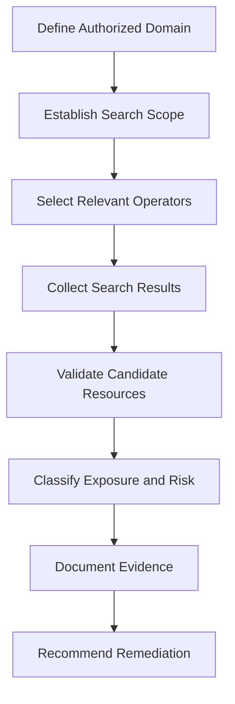

<div align="center">

# 🌍 Open-Source Intelligence (OSINT)

**Collecting, evaluating, and analyzing publicly available information, from WHOIS to Google Dorking.**


</div>

> [!WARNING]
> Use these techniques only on domains and assets you own or are authorized to assess. Being able to find information does not mean you have permission to access or use it.

---

## 📖 Overview

OSINT is the process of collecting, evaluating, and analyzing publicly available information.

I study OSINT to understand how publicly accessible information can reveal domain infrastructure, exposed services, technology choices, and relationships between digital assets.

## 📚 Table of Contents

| # | Section |
|---|---------|
| 1 | [WHOIS](#1--whois) |
| 2 | [Shodan](#2--shodan) |
| 3 | [DNS Reconnaissance](#3--dns-reconnaissance) |
| 4 | [Google Dorking](#4--google-dorking) |
| 5 | [theHarvester](#5--theharvester) |
| 6 | [Maltego](#6--maltego) |
| 7 | [OSINT Workflow](#7--osint-workflow) |
| 8 | [Key Lesson](#8--key-lesson) |

---

## 1. 🔎 WHOIS

**Purpose:** Retrieve available domain registration information.

```bash
whois example.com
```

Depending on registry policies and privacy settings, results may include registration dates, registrar information, and nameservers.

> 🧠 **What I learned:** Registration data can provide investigative context, but it does not necessarily prove who owns or operates a website.

---

## 2. 📡 Shodan

**Purpose:** Search indexed information about internet-connected devices and services.

Website: https://www.shodan.io/

Shodan helps security researchers study exposed service banners, internet-facing systems, and publicly visible technologies.

> 🧠 **What I learned:** A search result is an observation, not proof that a device is currently reachable or vulnerable.

---

## 3. 🌐 DNS Reconnaissance

```bash
dig example.com A
dig example.com MX
dig example.com NS
```

| Record | Meaning |
|--------|---------|
| **A** | IPv4 address record |
| **AAAA** | IPv6 address record |
| **MX** | Mail exchanger |
| **NS** | Nameserver |
| **TXT** | Text data, including some email-security policies |
| **CNAME** | Canonical-name alias |

DNS information can help explain how a domain's services are configured.

---

## 4. 🕵️ Google Dorking

**Advanced OSINT & Web Reconnaissance**

| | |
|---|---|
| **Domain** | Cybersecurity, OSINT, Web Security, Information Gathering |
| **Level** | Intermediate to Advanced |
| **Environment** | Web Browser, Google Search |
| **Focus** | Search operators, attack-surface discovery, public information exposure, security analysis |

### 4.1 Introduction

Google Dorking, also known as Google Hacking, is an information-gathering technique that uses advanced search operators to find publicly indexed information more precisely than ordinary keyword searches.

Security professionals use it during OSINT, reconnaissance, and authorized attack-surface assessments to discover exposed documents, publicly accessible resources, technology references, and potentially sensitive information.

It does **not** exploit a vulnerability in Google. It uses Google's indexing and search capabilities to locate information that may already be accessible on the web.

It's valuable because indexed information can reveal an organization's digital footprint: forgotten resources, outdated documents, development artifacts, and unintentionally exposed files.

**Objectives**

- Understand advanced Google search operators
- Perform targeted information discovery
- Identify publicly indexed files and web resources
- Investigate exposed information using OSINT techniques
- Recognize potential information-disclosure risks
- Document findings and recommend remediation

### 4.2 How It Works

Search engines discover content through crawling and indexing. Google Dorking combines search operators to narrow results to specific conditions.

A normal search might return pages containing "security policy". An advanced query can restrict results to a domain and file type:

```text
site:example.com filetype:pdf "security policy"
```

This searches for indexed PDF documents on `example.com` that match the phrase.

> [!NOTE]
> Search results do not guarantee that a resource is currently accessible, sensitive, or vulnerable. Indexes can be outdated, and access restrictions may differ from what snippets suggest.

### 4.3 Essential Search Operators

| Operator | Function | Example |
|----------|----------|---------|
| `site:` | Restricts results to a domain or website | `site:example.com` |
| `filetype:` | Filters by file extension or document type | `filetype:pdf cybersecurity` |
| `inurl:` | Searches for a term in the URL | `inurl:docs security` |
| `intitle:` | Searches for a term in the page title | `intitle:"security policy"` |
| `intext:` | Searches for a term in the page body | `intext:"incident response"` |
| `"exact phrase"` | Searches for a specific phrase | `"access control policy"` |
| `-term` | Excludes results containing a term | `security -jobs` |
| `OR` | Matches either alternative | `security OR cybersecurity` |
| `before:` | Results before a date | `security before:2025-01-01` |
| `after:` | Results after a date | `security after:2025-01-01` |

> Operator behavior and supported syntax can change. Validate important queries against Google's current search behavior.

### 4.4 Domain-Specific Reconnaissance

`site:` defines the scope of a search.

**Publicly indexed pages**

```text
site:example.com
```

*Purpose:* Discover pages from a domain that Google has indexed.
*Security relevance:* Gives an initial view of an organization's publicly searchable web presence.

**Indexed PDF documents**

```text
site:example.com filetype:pdf
```

*Purpose:* Identify indexed PDFs associated with a domain.
*Security relevance:* Documents may contain outdated contact information, internal terminology, metadata, or content that shouldn't be public.

**Public office documents**

```text
site:example.com (filetype:doc OR filetype:docx OR filetype:xlsx)
```

*Purpose:* Search indexed Word and Excel documents.
*Security relevance:* Supports document-exposure reviews and checks for unintended publication of business information.

### 4.5 URL and Page-Title Analysis

**URL-based search**

```text
site:example.com inurl:docs
```

**Page-title search**

```text
site:example.com intitle:"documentation"
```

**Error and diagnostic information**

```text
site:example.com "configuration error"
```

> 🧠 An error message is not automatically a vulnerability. Confirm the context, exposure, reproducibility, and security impact before reporting a finding.

### 4.6 File Exposure and Information Disclosure

Publicly indexed files can unintentionally reveal organizational information. Worth reviewing during an authorized assessment:

- Outdated policy documents
- Publicly exposed technical documentation
- Development or deployment instructions
- Internal contact directories
- Old backups mistakenly published on a website
- Configuration examples containing sensitive-looking values

```text
site:example.com filetype:txt "configuration"
```

```text
site:example.com filetype:pdf "internal use"
```

These queries identify **candidates for review**, not confirmed exposures. Verify classification, contents, access requirements, and publication authorization before assigning risk.

### 4.7 Publicly Exposed Administrative Interfaces

Search engines may index login pages, admin documentation, or interface descriptions. A defensive review of an **owned** domain can look for them:

```text
site:example.com intitle:"admin"
```

This may find pages with "admin" in the title, but it does not establish that an interface is accessible or vulnerable.

During an authorized assessment, validate whether management services are intentionally public, whether authentication is enforced, and whether access controls follow policy. **Do not attempt to bypass authentication or access systems outside the approved scope.**

### 4.8 Reconnaissance Workflow



1. **Define scope:** Identify the organization, domains, subdomains, and assets explicitly included.
2. **Select operators:** Choose them based on the objective (document discovery, URL analysis, public documentation review).
3. **Review results:** Record URLs, titles, dates, and why each result is relevant.
4. **Validate findings:** Does the resource exist, is it publicly accessible, is the information sensitive, was publication authorized?
5. **Assess risk:** Consider confidentiality, business impact, access controls, and whether the exposure is a realistic security concern.
6. **Report:** Document evidence and recommend removing, restricting, correcting, or de-indexing content.

### 4.9 Google Dorking in the OSINT Process

| OSINT activity | Purpose |
|----------------|---------|
| Domain research | Understand the organization's public web presence |
| Search-engine reconnaissance | Locate indexed pages and documents |
| Metadata review | Identify document properties and revealing information |
| DNS investigation | Understand domain and name-resolution records |
| Certificate research | Discover publicly documented certificate and hostname information |
| Technology identification | Identify publicly observable technologies and services |
| Evidence correlation | Check whether separate observations support a meaningful finding |

A search result alone rarely establishes a complete security finding.

### 4.10 Defensive Applications

Google Dorking also helps reduce an organization's own public exposure.

**Document exposure review.** Periodically review your domains for documents that shouldn't be indexed:

- Review publication permissions
- Remove sensitive content from public web directories
- Audit document metadata
- Replace exposed secrets rather than merely hiding them
- Restrict access to private resources
- Request search-index removal when appropriate

**Search index management.**

- `robots.txt` gives crawling guidance to compliant crawlers. It is **not** an access-control mechanism.
- A `noindex` directive influences indexing but is **not** a substitute for authentication or authorization.
- Protect sensitive resources at the application and server layers.

**Secret exposure.** If a public document or repository contains a real credential, API key, or token:

1. Treat the value as potentially compromised
2. Revoke or rotate it
3. Investigate relevant access logs
4. Remove the exposure at its source
5. Review related systems for unauthorized activity
6. Request removal of cached or indexed copies where appropriate

> [!IMPORTANT]
> Removing a file from search results does not invalidate a leaked secret.

### 4.11 Limitations and False Positives

- Results are limited to content Google has discovered and indexed
- Indexes can contain outdated URLs or cached descriptions
- Authentication-protected content may not be indexed
- Operators don't consistently expose every matching resource
- A search result does not prove a vulnerability exists
- Snippets may omit context that changes the interpretation
- A public resource may be intentionally published

Google Dorking is best treated as a **discovery technique**, not a complete vulnerability assessment.

### 4.12 Finding Documentation Template

```text
Finding title:
Affected domain or URL:
Discovery method: Google Search operators
Date observed:
Evidence:
Information exposed:
Access requirements:
Security impact:
Severity and justification:
Recommended remediation:
Validation status: Confirmed / Unconfirmed / Not Applicable
```

> [!CAUTION]
> Do not publish confidential screenshots, private data, credentials, or sensitive organizational information in a public repository.

### 4.13 Security Best Practices

- Perform targeted searches only within an authorized scope
- Don't assume discoverability implies permission to access or use information
- Avoid downloading or redistributing sensitive documents unnecessarily
- Do not test credentials found in exposed material
- Redact sensitive evidence before reporting or publication
- Validate security impact before assigning severity
- Recommend access-control changes instead of relying only on search-index removal
- Record the date and exact query used so findings are reproducible

### 4.14 Technical Summary

Google Dorking is a practical OSINT technique that uses advanced search operators to discover publicly indexed information efficiently. Its effectiveness depends on choosing appropriate queries, understanding search-engine behavior, validating results, and distinguishing ordinary public information from genuine security exposure.

**Key skills demonstrated**

- Advanced search-operator usage
- Domain-scoped reconnaissance
- Public document discovery
- URL and page-title analysis
- Information-disclosure assessment
- OSINT evidence validation
- Exposure classification and reporting

> 🧠 **Security lesson:** Publicly indexed documents should be reviewed to ensure they do not expose confidential information.

### 4.15 References

- [Google Search Help](https://support.google.com/websearch/)
- [Google Search Central](https://developers.google.com/search/docs)
- [Google Advanced Search](https://www.google.com/advanced_search)
- [OWASP](https://owasp.org/)
- [MITRE ATT&CK](https://attack.mitre.org/)

*Documentation type: technical study and authorized reconnaissance reference. Add actual observations and sanitized evidence when practical exercises have been completed.*

---

## 5. 🌾 theHarvester

Project: https://github.com/laramies/theHarvester

theHarvester gathers publicly discoverable information associated with a domain from supported sources.

Example command pattern:

```bash
theHarvester -d example.com -b crtsh
```

Source availability and supported options may vary by version.

> 🧠 **What I learned:** Automated collection saves time, but results may be incomplete, outdated, or incorrectly associated with a target.

---

## 6. 🕸️ Maltego

Website: https://www.maltego.com/

Maltego supports visual link analysis across entities such as domains, IP addresses, organizations, and other data points.

> 🧠 **What I learned:** Visual relationships help organize investigations, but a displayed connection is not automatic proof of ownership or wrongdoing.

---

## 7. 🔄 OSINT Workflow

1. Define the objective and authorized scope
2. Identify known domains and public identifiers
3. Collect registration and DNS information
4. Review relevant public sources
5. Correlate and verify findings
6. Document sources, timestamps, and limitations
7. Recommend appropriate security improvements

---

## 8. 🎯 Key Lesson

OSINT is not just gathering information. It requires evaluating sources, checking accuracy, understanding context, and protecting personal information.

---

<div align="center">

**Verify everything. Stay in scope. Protect people's privacy.** 🔐

</div>
