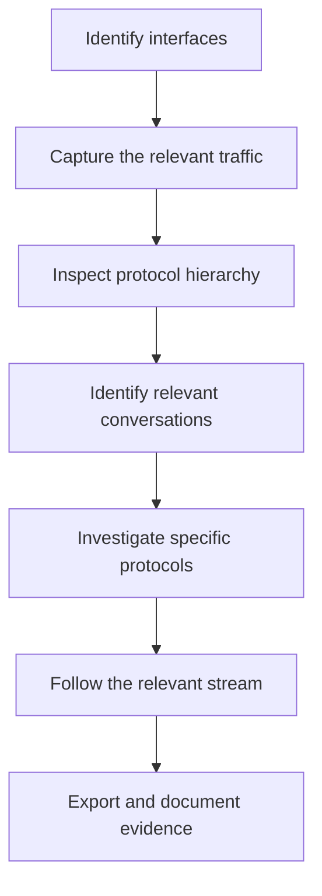

<div align="center">

# 🦈 Advanced Wireshark & TShark Guide

**Packet analysis, TCP stream reconstruction, protocol inspection, traffic filtering, and cybersecurity investigation.**


</div>

> [!WARNING]
> **Authorized use only.** Capture and analyze traffic only from your own devices, networks, or approved lab environments. Packet captures can contain sensitive information, including credentials, session cookies, and private communications.

---

## 📚 Table of Contents

| # | Section |
|---|---------|
| 1 | [Wireshark Basics](#1--wireshark-basics) |
| 2 | [Advanced Display Filters](#2--advanced-display-filters) |
| 3 | [Following TCP, HTTP, and TLS Streams](#3--following-tcp-http-and-tls-streams) |
| 4 | [Analyzing TCP Connections](#4--analyzing-tcp-connections) |
| 5 | [DNS Investigation](#5--dns-investigation) |
| 6 | [HTTP and Web Traffic Analysis](#6--http-and-web-traffic-analysis) |
| 7 | [TLS and HTTPS Analysis](#7--tls-and-https-analysis) |
| 8 | [Statistics and Traffic Analysis](#8--statistics-and-traffic-analysis) |
| 9 | [Exporting Objects and Data](#9--exporting-objects-and-data) |
| 10 | [Capture Filters vs. Display Filters](#10--capture-filters-vs-display-filters) |
| 11 | [TShark: Advanced CLI Analysis](#11--tshark-advanced-command-line-analysis) |
| 12 | [Investigating Suspicious Traffic](#12--investigating-suspicious-traffic) |
| 13 | [Advanced Wireshark Settings](#13--advanced-wireshark-settings) |
| 14 | [Troubleshooting](#14--troubleshooting) |
| 15 | [Practical Investigation Workflow](#15--practical-investigation-workflow) |
| 16 | [Useful References](#16--useful-references) |

---

## ⚡ Quick Filter Cheat Sheet

| I want to... | Filter |
|--------------|--------|
| See traffic with one host | `ip.addr == 192.168.1.10` |
| See only TCP SYN packets | `tcp.flags.syn == 1 && tcp.flags.ack == 0` |
| See retransmissions | `tcp.analysis.retransmission` |
| See DNS queries | `dns.flags.response == 0` |
| See POST requests | `http.request.method == "POST"` |
| See TLS ClientHello | `tls.handshake.type == 1` |
| Find a stream number | `tcp.stream == 0` |

---

## 1. 🧰 Wireshark Basics

Start Wireshark:

```bash
wireshark
```

List available capture interfaces:

```bash
tshark -D
```

Capture on a specific interface:

```bash
sudo tshark -i eth0
```

Save packets to a file:

```bash
sudo tshark -i eth0 -w network-capture.pcapng
```

Read a saved capture:

```bash
wireshark network-capture.pcapng
```

Read it from the terminal:

```bash
tshark -r network-capture.pcapng
```

Find your real interface name:

```bash
ip -br addr
```

### Essential interface features

| Feature | Purpose |
|---------|---------|
| Display Filter bar | Filter captured packets |
| Packet List | View packets and summary info |
| Packet Details | Expand protocol fields for a selected packet |
| Packet Bytes | Inspect raw bytes in hex and ASCII |
| Follow Stream | Reconstruct a conversation between endpoints |
| Expert Information | Review protocol warnings and anomalies |
| Conversations | Summarize communication between endpoints |
| Endpoints | List hosts seen in the capture |
| I/O Graphs | Visualize traffic volume and patterns |

---

## 2. 🔎 Advanced Display Filters

> Display filters select which packets *appear*. They never remove packets from the original capture.

### 2.1 Host and IP filters

```text
ip.addr == 192.168.1.10
```

```text
ip.src == 192.168.1.10
```

```text
ip.dst == 192.168.1.10
```

Traffic between two hosts:

```text
ip.addr == 192.168.1.10 && ip.addr == 192.168.1.20
```

Exclude a host:

```text
!ip.addr == 192.168.1.10
```

IPv6 only:

```text
ipv6
```

### 2.2 TCP filters

```text
tcp
```

```text
tcp.port == 443
```

Initial SYN packets:

```text
tcp.flags.syn == 1 && tcp.flags.ack == 0
```

TCP resets:

```text
tcp.flags.reset == 1
```

Retransmissions:

```text
tcp.analysis.retransmission
```

Fast retransmissions:

```text
tcp.analysis.fast_retransmission
```

Duplicate ACKs:

```text
tcp.analysis.duplicate_ack
```

Zero-window announcements:

```text
tcp.analysis.zero_window
```

All analysis flags:

```text
tcp.analysis.flags
```

### 2.3 UDP and ICMP filters

```text
udp
```

```text
udp.port == 53
```

```text
icmp
```

Echo requests:

```text
icmp.type == 8
```

Echo replies:

```text
icmp.type == 0
```

### 2.4 DNS filters

```text
dns
```

Queries:

```text
dns.flags.response == 0
```

Responses:

```text
dns.flags.response == 1
```

Errors:

```text
dns.flags.rcode != 0
```

A specific domain:

```text
dns.qry.name == "example.com"
```

DNS over TCP:

```text
tcp.port == 53
```

> Encrypted DNS transports (like DNS over HTTPS) won't necessarily be decoded by ordinary DNS filters.

### 2.5 HTTP filters

```text
http
```

```text
http.request
```

POST requests:

```text
http.request.method == "POST"
```

GET requests:

```text
http.request.method == "GET"
```

```text
http.response
```

Error responses:

```text
http.response.code >= 400
```

A specific host:

```text
http.host == "example.com"
```

A specific URI:

```text
http.request.uri contains "/login"
```

> These fields apply only to traffic Wireshark can dissect as HTTP. HTTPS content stays encrypted unless decryption is configured.

### 2.6 TLS filters

```text
tls
```

ClientHello:

```text
tls.handshake.type == 1
```

ServerHello:

```text
tls.handshake.type == 2
```

Certificate messages:

```text
tls.handshake.type == 11
```

TLS alerts:

```text
tls.alert_message
```

TLS on port 443:

```text
tcp.port == 443 && tls
```

> TLS 1.3 encrypts much of the handshake after ServerHello. Certificate visibility depends on the protocol version, capture point, and whether decryption is available.

### 2.7 Frame and size filters

```text
frame.len > 1400
```

```text
frame.len < 100
```

Byte sequence search:

```text
frame contains "password"
```

> A match doesn't prove a credential was transmitted — it could be unrelated text or data.

### 2.8 Combining filters

DNS queries from one host:

```text
ip.src == 192.168.1.10 && dns.flags.response == 0
```

HTTP requests or DNS traffic:

```text
http.request || dns
```

Retransmissions involving a host:

```text
ip.addr == 192.168.1.10 && tcp.analysis.retransmission
```

HTTP errors excluding one host:

```text
http.response.code >= 400 && !ip.addr == 192.168.1.20
```

> 💡 Use `&&` for AND, `||` for OR, `!` for NOT. Parentheses help with complex expressions.

---

## 3. 🧵 Following TCP, HTTP, and TLS Streams

Reconstructs the application data exchanged in a conversation, when the capture has the necessary packets.

### 3.1 Follow a TCP stream

<details>
<summary>Steps</summary>

1. Open a capture file
2. Select a TCP packet belonging to the conversation
3. Right-click the packet
4. Select **Follow → TCP Stream**
5. Inspect the reconstructed conversation
6. Use the stream selector to identify the conversation
7. Change the display format if needed
8. Close the stream window to return to the packet list

</details>

> Menu labels can vary by version.

### 3.2 Follow an HTTP stream

1. Find a packet matching `http`
2. Select a request or response
3. Right-click → **Follow → HTTP Stream** (if available)
4. Inspect headers and any unencrypted body data
5. Note the method, host, URI, status code, and relevant content

Useful filter first:

```text
http.request || http.response
```

> [!CAUTION]
> Plain HTTP is not encrypted. Credentials or session tokens may be visible in the capture. Use synthetic data in labs and keep real secrets out of reports.

### 3.3 Follow a TLS stream

Select a TLS packet and use **Follow → TLS Stream** if available. This isolates the relevant conversation but does **not** decrypt HTTPS.

Without decryption, you may still inspect:

- Source and destination addresses
- Ports
- Visible TLS handshake information
- Record sizes and timing
- Some server-name information, when exposed
- Connection setup and teardown

### 3.4 Find the stream number

```text
tcp.stream == 0
```

```text
tcp.stream == 5
```

> Stream numbers are assigned per-capture and aren't universal identifiers. Expand **Transmission Control Protocol** in Packet Details to find the stream index, or right-click the field and **Apply as Filter**.

### 3.5 Follow a UDP conversation

Wireshark may offer **Follow → UDP Stream**. UDP has no TCP-style connection, so a reconstructed UDP stream is a grouping of related datagrams, not a reliable byte stream.

### 3.6 What to look for in a stream

- Which endpoint initiated the conversation?
- Which request or protocol message came first?
- What did the server return?
- Were there errors, redirects, or unexpected responses?
- Was sensitive information sent without encryption?
- Did the connection end normally or reset unexpectedly?
- Is the capture incomplete or missing part of the conversation?

---

## 4. 📈 Analyzing TCP Connections

### 4.1 The TCP handshake

1. Client sends SYN
2. Server responds SYN-ACK
3. Client sends ACK

Initial SYN packets:

```text
tcp.flags.syn == 1 && tcp.flags.ack == 0
```

SYN-ACK packets:

```text
tcp.flags.syn == 1 && tcp.flags.ack == 1
```

TCP resets:

```text
tcp.flags.reset == 1
```

> A SYN packet alone doesn't prove a port scan — it could be ordinary connection setup, a retry, or other normal behavior.

### 4.2 Detect retransmissions

```text
tcp.analysis.retransmission
```

Correlate with acknowledgments, timing, and the capture location — retransmissions can reflect packet loss, congestion, or capture artifacts.

### 4.3 Sequence and acknowledgment numbers

1. Select a TCP packet
2. Expand **Transmission Control Protocol**
3. Inspect sequence number, ack number, flags, window size, payload length
4. Compare subsequent packets in the same stream

> Wireshark's relative sequence numbers are usually easier to read than raw ones.

### 4.4 TCP stream graphs

Select a TCP packet → **Statistics → TCP Stream Graphs** (where available).

| Graph | Shows |
|-------|-------|
| Time-Sequence (Stevens) | Sequence numbers over time |
| Throughput | Data transfer rate over time |
| Round Trip Time | Acknowledgment timing |
| Window Scaling | Advertised receive-window behavior |

---

## 5. 🌐 DNS Investigation

### 5.1 Queries and responses

```text
dns.flags.response == 0
```

```text
dns.flags.response == 1
```

```text
dns.flags.rcode != 0
```

### 5.2 Inspect a DNS packet

Expand: **Domain Name System → Queries / Answers / Authority records / Additional records.**

Record the queried name, query type, response code, returned address, and timing.

### 5.3 Investigate unusual DNS behavior

- Repeated failed queries
- Unexpected domains
- High volumes of unique queries
- Unusual query types for the environment
- Long or irregular subdomain labels
- Large differences between query and response patterns

> 🧠 These are investigation leads, not proof of malicious activity — legitimate applications can produce similar patterns.

---

## 6. 🌍 HTTP and Web Traffic Analysis

### 6.1 Inspect requests

```text
http.request
```

Expand **Hypertext Transfer Protocol** for: request method, Host header, request URI, User-Agent, Content-Type, Content-Length, cookies (if unencrypted).

### 6.2 Inspect responses

```text
http.response
```

Check: status code, Server header, Content-Type, Content-Length, redirect headers, response body.

### 6.3 Find POST requests

```text
http.request.method == "POST"
```

> POST requests aren't inherently malicious — check context, destination, headers, and content.

### 6.4 Export HTTP objects

<details>
<summary>Steps</summary>

1. **File → Export Objects → HTTP**
2. Review the listed objects
3. Select an object
4. Export it to a controlled analysis directory
5. Inspect the file safely before opening or executing it

</details>

> Not every capture has exportable objects. Encrypted HTTPS payloads can't normally be exported as readable HTTP objects without successful decryption.

---

## 7. 🔐 TLS and HTTPS Analysis

### 7.1 Inspect the handshake

```text
tls.handshake
```

```text
tls.handshake.type == 1
```

```text
tls.handshake.type == 2
```

Inspect supported versions, cipher suites, extensions, and exposed server-name info.

### 7.2 HTTPS limitations

HTTPS encrypts application data — a capture alone generally can't reveal the full request or response body. For authorized troubleshooting, Wireshark can use a TLS key log file if the client supports generating one.

<details>
<summary>Typical workflow</summary>

1. Configure the test browser/app to generate a TLS key log file
2. In Wireshark: **Edit → Preferences → Protocols → TLS**
3. Locate the (Pre)-Master-Secret log filename field (or equivalent)
4. Select the key log file
5. Reopen or reload the capture
6. Check whether the relevant traffic can now be dissected

</details>

> [!CAUTION]
> A key log file contains sensitive session secrets. Keep it private, never commit it to GitHub, and delete it when no longer needed.

### 7.3 Inspect certificate information

When visible: subject and issuer, validity dates, Subject Alternative Names, certificate chain, negotiated TLS parameters.

> A certificate message isn't visible in every TLS session, particularly with newer TLS versions or resumed sessions.

---

## 8. 📊 Statistics and Traffic Analysis

### 8.1 Protocol Hierarchy

**Statistics → Protocol Hierarchy** — shows which protocols account for the captured traffic.

### 8.2 Conversations

**Statistics → Conversations** — review Ethernet, IPv4, IPv6, TCP, UDP conversations. Look for:

- Frequent communication between particular endpoints
- Large byte counts
- Unusual external destinations
- Unexpected ports
- Differences between sent and received traffic

### 8.3 Endpoints

**Statistics → Endpoints** — summarizes observed endpoints (not every host on the network, just what's in the capture).

### 8.4 I/O Graphs

**Statistics → I/O Graphs** — visualize packet counts or bytes over time; add separate filters to compare categories (e.g. DNS vs. retransmissions).

### 8.5 Expert Information

**Analyze → Expert Information** (or equivalent) — warnings and notes like retransmissions, malformed packets, protocol anomalies.

> A diagnostic aid, not a definitive security verdict.

---

## 9. 📤 Exporting Objects and Data

### 9.1 Export HTTP objects

**File → Export Objects → HTTP** — export only what the investigation needs, into a controlled directory.

### 9.2 Export selected packets

1. Apply a display filter
2. Select the desired packets
3. **File → Export Specified Packets**
4. Choose the packet range and output format

> Exporting selected packets is different from exporting reassembled application objects.

### 9.3 Save filtered packets with TShark

```bash
tshark -r network-capture.pcapng -Y "dns" -w dns-only.pcapng
```

```bash
tshark -r network-capture.pcapng -Y "tcp.analysis.retransmission" -w retransmissions.pcapng
```

### 9.4 Extract fields into a report

```bash
tshark -r network-capture.pcapng -T fields \
  -e frame.number \
  -e frame.time \
  -e ip.src \
  -e ip.dst \
  -e _ws.col.Protocol
```

Redirect to a file:

```bash
tshark -r network-capture.pcapng -T fields \
  -e frame.number -e ip.src -e ip.dst -e _ws.col.Protocol \
  > packet-summary.tsv
```

---

## 10. ⚖️ Capture Filters vs. Display Filters

| | Capture filters | Display filters |
|---|---|---|
| **Purpose** | Limit what's *collected* | Limit what's *shown* |
| **Syntax** | libpcap capture-filter syntax | Wireshark's own filter syntax |
| **Reversible?** | No — omitted packets are gone | Yes — just hides the view |

**Capture filter examples**

```text
host 192.168.1.10
```

```text
tcp port 443
```

```text
port 53
```

```text
host 192.168.1.10 and host 192.168.1.20
```

```text
tcp and not port 22
```

**Display filter examples**

```text
ip.addr == 192.168.1.10
```

```text
tcp.port == 443
```

```text
dns
```

```text
tcp.analysis.retransmission
```

---

## 11. 💻 TShark: Advanced Command-Line Analysis

### 11.1 Read a capture

```bash
tshark -r network-capture.pcapng
```

```bash
tshark -r network-capture.pcapng -Y "dns"
```

```bash
tshark -r network-capture.pcapng -Y "tcp.analysis.retransmission"
```

### 11.2 Extract DNS fields

```bash
tshark -r network-capture.pcapng -Y "dns.flags.response == 0" \
  -T fields \
  -e frame.time \
  -e ip.src \
  -e dns.qry.name \
  -e dns.qry.type
```

### 11.3 Extract HTTP request details

```bash
tshark -r network-capture.pcapng -Y "http.request" \
  -T fields \
  -e frame.time \
  -e ip.src \
  -e ip.dst \
  -e http.request.method \
  -e http.host \
  -e http.request.uri
```

> Field availability depends on what protocols the capture decodes.

### 11.4 List conversations

```bash
tshark -r network-capture.pcapng -q -z conv,tcp
```

```bash
tshark -r network-capture.pcapng -q -z conv,udp
```

Protocol hierarchy stats:

```bash
tshark -r network-capture.pcapng -q -z io,phs
```

### 11.5 Inspect available fields

```bash
tshark -G fields | grep -i tcp
```

```bash
tshark -G fields | grep -i dns
```

```bash
tshark -G fields | grep -i tls
```

Handy when a filter fails because the field name isn't what you expected.

---

## 12. 🚨 Investigating Suspicious Traffic

> No single filter proves an attack occurred — these are investigation leads.

### 12.1 Possible port-scanning activity

```text
tcp.flags.syn == 1 && tcp.flags.ack == 0
```

Examine source address, destination ports, time range, and whether connections completed. A high SYN count *may* indicate scanning, but normal apps can also open many connections.

### 12.2 Repeated TCP failures

```text
tcp.flags.reset == 1 || tcp.analysis.retransmission
```

Determine whether it's network problems, service misconfiguration, or something suspicious.

### 12.3 Unusual DNS activity

```text
dns.flags.response == 0
```

Look at repeated queries, unexpected domains, and unusual patterns compared to the host's normal behavior.

### 12.4 Cleartext HTTP

```text
http
```

Check whether sensitive info is sent unencrypted. Never copy real credentials or tokens into reports.

### 12.5 Unusual outbound connections

```text
tcp.flags.syn == 1 && tcp.flags.ack == 0
```

Combine with endpoint/conversation statistics. You need environmental context to judge whether a destination is unusual.

### 12.6 Large packet bursts

```text
frame.len > 1400
```

Use I/O Graphs and conversation statistics. Large frames alone don't prove exfiltration or an attack.

---

## 13. ⚙️ Advanced Wireshark Settings

### 13.1 Name resolution

**View → Name Resolution**

> Makes captures more readable but can generate DNS lookups and obscure raw addresses. For forensic work, preserve raw IPs and document resolution settings used.

### 13.2 Coloring rules

**View → Coloring Rules** — built-in rules often highlight retransmissions, resets, and other TCP events.

<details>
<summary>Add a custom rule</summary>

1. Open Coloring Rules
2. Add a new rule
3. Enter a descriptive name
4. Set the display filter
5. Choose foreground/background colors
6. Save the rule

</details>

Example filter for TCP resets:

```text
tcp.flags.reset == 1
```

### 13.3 Customize columns

<details>
<summary>Steps</summary>

1. Select a packet
2. Expand the desired field in Packet Details
3. Right-click the field
4. Choose **Apply as Column** (if available)

</details>

**Useful columns:** source/destination IP, source/destination port, TCP stream index, TCP flags, TCP sequence number, DNS query name, HTTP request method, HTTP host, HTTP response code.

### 13.4 TCP analysis preferences

**Edit → Preferences → Protocols → TCP**

> Don't disable reassembly just to simplify a capture — it can prevent higher-level protocols from decoding correctly.

### 13.5 Time display format

**View → Time Display Format**

Relative timing helps analyze delays; absolute timestamps help correlate with other logs. Verify the capture's timestamp accuracy and time zone first.

### 13.6 Protocol dissection

If Wireshark decodes traffic as the wrong protocol, check the port and protocol details. **Decode As** can help for nonstandard ports — but forcing a decoder doesn't prove the traffic actually follows that protocol.

### 13.7 Manage capture options

Before capturing:

1. Choose the correct interface
2. Set an appropriate capture filter if needed
3. Choose a manageable file size and duration
4. Consider ring-buffer options for long-running captures
5. Avoid capturing unrelated traffic
6. Confirm where the capture file will be stored

---

## 14. 🛠️ Troubleshooting

### Wireshark cannot capture packets

```bash
tshark -D
```

```bash
ip -br link
```

```bash
wireshark --version
```

> Capture permissions depend on the OS and install. Don't change permissions broadly or run the GUI as root by default — use your distribution's documented capture-permission setup.

### The interface is missing

- Verify the interface exists
- Check whether the adapter or driver is working
- Confirm the interface is supported by the capture backend
- In a VM, check whether the virtual network adapter is connected
- For Wi-Fi monitor mode, verify adapter/driver support

### Wireshark doesn't show HTTP content

- Confirm whether the traffic is plain HTTP or HTTPS
- Check whether the capture includes the complete conversation
- Verify the correct protocol is being dissected
- For authorized HTTPS troubleshooting, configure a supported TLS key log file if available

### A display filter is rejected

- Confirm syntax and spelling
- Use **Analyze → Display Filter Expression** to find valid fields
- Search available fields:

```bash
tshark -G fields | grep -i 'field-name'
```

### A TCP stream appears incomplete

The capture may have started late, ended early, missed packets, or come from the wrong interface. Check timestamps, retransmissions, sequence numbers, and whether both directions are present.

---

## 15. 🧭 Practical Investigation Workflow



**Step 1 — Identify interfaces**

```bash
ip -br addr
```

```bash
tshark -D
```

**Step 2 — Capture the relevant traffic**

```bash
sudo tshark -i eth0 -w lab-capture.pcapng
```

Stop once enough evidence is collected.

**Step 3 — Inspect the protocol hierarchy**

```bash
tshark -r lab-capture.pcapng -q -z io,phs
```

**Step 4 — Identify the relevant conversations**

```bash
tshark -r lab-capture.pcapng -q -z conv,tcp
```

**Step 5 — Investigate specific protocols**

```text
dns
```

```text
http
```

```text
tcp.analysis.retransmission
```

**Step 6 — Follow the relevant stream**

Select a packet, right-click, **Follow → TCP Stream** (or the appropriate protocol).

**Step 7 — Export and document evidence**

Record:

- Investigation objective
- Capture source and time range
- Tool and version
- Filters used
- Relevant packet numbers and stream IDs
- Actual observed results
- Interpretation and alternative explanations
- Recommended next steps

> [!NOTE]
> Distinguish actual observations from example commands and hypothetical output. A filter returning packets is not, by itself, proof of malicious activity.

---

## 16. 📎 Useful References

- [Wireshark User's Guide](https://www.wireshark.org/docs/wsug_html_chunked/)
- [Wireshark Display Filter Reference](https://www.wireshark.org/docs/dfref/)
- [TShark Manual](https://www.wireshark.org/docs/man-pages/tshark.html)
- [Wireshark Wiki](https://wiki.wireshark.org/)
- [TCP/IP Guide](https://www.tcpipguide.com/)
- [RFC Editor](https://www.rfc-editor.org/)

---

<div align="center">

**Capture only what you need. Protect what you collect. Verify before you conclude.** 🦈

</div>
