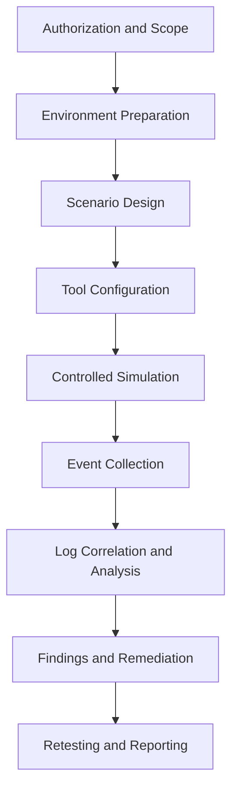
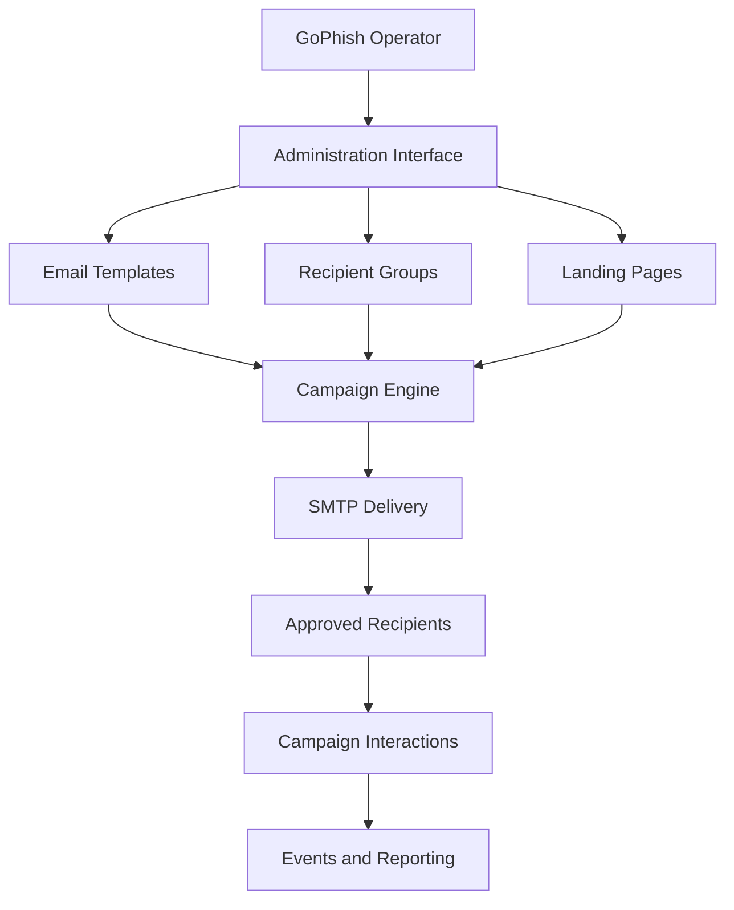
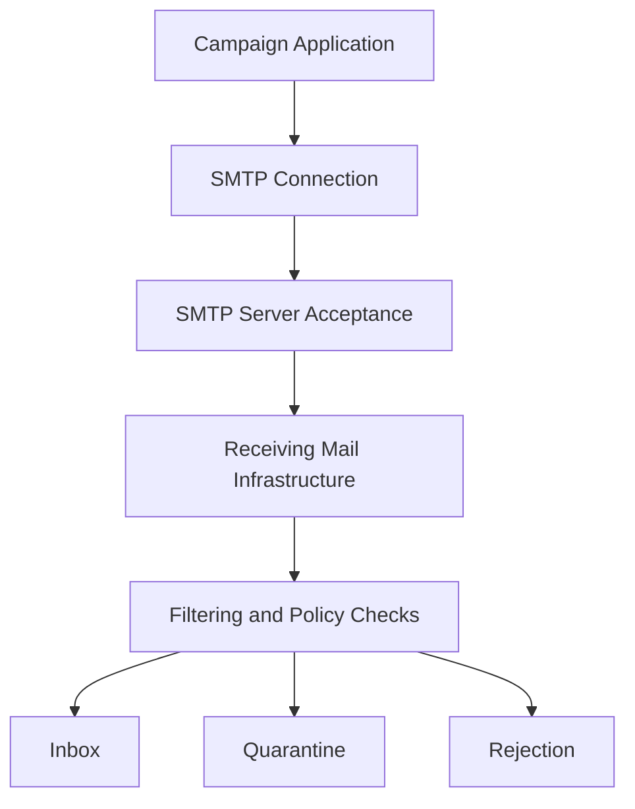
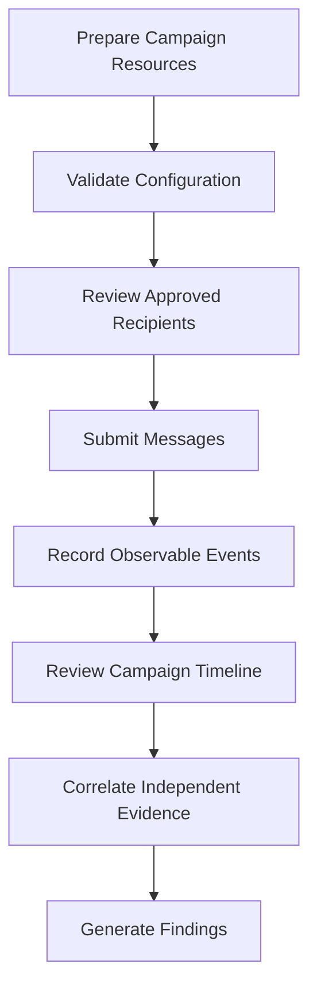
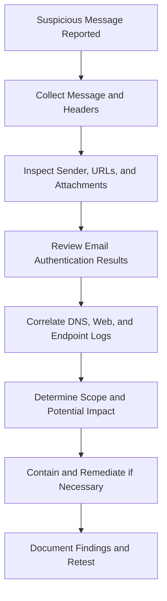

 <div align="center">

# 🎭 Advanced Social Engineering Security Assessment

### GoPhish & Social-Engineer Toolkit (SET)

**Phishing simulation, campaign management, social-engineering assessment, event analysis, and defensive validation.**


</div>

> [!WARNING]
> **Authorized use only.** Conduct social-engineering assessments only with explicit permission and within a clearly defined scope. Use synthetic identities and controlled lab environments. Never collect real passwords, session tokens, or authentication codes.

---

## 📚 Table of Contents

| # | Section |
|---|---|
| 1 | [Introduction to Social Engineering](#1--introduction-to-social-engineering) |
| 2 | [Social Engineering Attack Surface](#2--social-engineering-attack-surface) |
| 3 | [GoPhish Technical Overview](#3--gophish-technical-overview) |
| 4 | [GoPhish Architecture and Components](#4--gophish-architecture-and-components) |
| 5 | [GoPhish Environment and Configuration](#5--gophish-environment-and-configuration) |
| 6 | [Email Templates and Recipient Groups](#6--email-templates-and-recipient-groups) |
| 7 | [SMTP and Email Delivery](#7--smtp-and-email-delivery) |
| 8 | [Landing Pages and Tracking](#8--landing-pages-and-tracking) |
| 9 | [Campaign Lifecycle and Event Analysis](#9--campaign-lifecycle-and-event-analysis) |
| 10 | [GoPhish Metrics and Reporting](#10--gophish-metrics-and-reporting) |
| 11 | [GoPhish API and Automation](#11--gophish-api-and-automation) |
| 12 | [Social-Engineer Toolkit (SET)](#12--social-engineer-toolkit-set) |
| 13 | [SET Architecture and Module Categories](#13--set-architecture-and-module-categories) |
| 14 | [SET Environment and Command-Line Operations](#14--set-environment-and-command-line-operations) |
| 15 | [SET Assessment Workflow](#15--set-assessment-workflow) |
| 16 | [GoPhish vs. SET](#16--gophish-vs-set) |
| 17 | [Email Security and Defensive Controls](#17--email-security-and-defensive-controls) |
| 18 | [Log Analysis and Incident Investigation](#18--log-analysis-and-incident-investigation) |
| 19 | [Common Errors and Troubleshooting](#19--common-errors-and-troubleshooting) |
| 20 | [Security Best Practices](#20--security-best-practices) |
| 21 | [Technical Summary](#21--technical-summary) |
| 22 | [References](#22--references) |

---

## ⚡ Quick Technical Reference

| I want to... | Command or concept |
|---|---|
| Locate GoPhish | `command -v gophish` |
| Inspect GoPhish process | `ps aux \| grep '[g]ophish'` |
| Inspect listening ports | `ss -lntp` |
| Inspect all listening sockets | `ss -lntup` |
| Inspect executable type | `file ./gophish` |
| Search for SET package | `apt search setoolkit` |
| Locate SET executable | `command -v setoolkit` |
| Inspect SET package | `dpkg -s set` |
| Review campaign events | GoPhish campaign dashboard |
| Review email authentication | SPF, DKIM, and DMARC |

---

## 1. 🎭 Introduction to Social Engineering

Social engineering is a security discipline concerned with how people can be manipulated into performing actions that compromise confidentiality, integrity, or availability.

Unlike attacks that primarily exploit software vulnerabilities, social engineering often targets human decision-making, trust, authority, urgency, curiosity, and established business procedures.

### 1.1 Common Social Engineering Techniques

| Technique | Description |
|---|---|
| Phishing | Fraudulent messages designed to influence recipients into clicking links, opening files, or disclosing information |
| Spear phishing | Targeted phishing that uses information about a particular person or organization |
| Pretexting | Creating a fabricated scenario or identity to influence a target |
| Baiting | Using an attractive offer or object to encourage unsafe behavior |
| Impersonation | Pretending to represent a trusted person, organization, or service |
| Business Email Compromise (BEC) | Abusing email accounts or impersonation to manipulate business processes, such as payments or confidential information transfers |

Social-engineering assessments evaluate both human responses and the technical controls surrounding these interactions.

The objective is not simply to determine whether someone clicked a link. A useful assessment examines whether security controls prevented the interaction, whether suspicious activity was reported, and whether the organization could investigate the event.

### 1.2 Security Objectives

A social-engineering assessment can evaluate:

- Employee security awareness.
- Email filtering and authentication.
- URL inspection and web protection.
- Endpoint detection and response.
- Suspicious-message reporting.
- Incident-response procedures.
- Identity verification and access-control processes.

### 1.3 Assessment Lifecycle



A structured lifecycle makes the assessment repeatable and allows findings to be compared over time.

---

## 2. 🌐 Social Engineering Attack Surface

A social-engineering scenario can involve several technical layers.

| Layer | Security concern | Defensive control |
|---|---|---|
| Human | Trust, urgency, and verification behavior | Awareness training and verification procedures |
| Email | Sender impersonation and malicious content | Secure email gateway and authentication |
| DNS | Resolution of suspicious destinations | DNS filtering and query monitoring |
| Web | Access to suspicious or unauthorized pages | URL filtering and browser protection |
| Endpoint | Execution of suspicious files or scripts | EDR, antivirus, and application control |
| Identity | Unauthorized account access | MFA and phishing-resistant authentication |
| Monitoring | Failure to recognize or investigate activity | Centralized logging and alerting |

An effective assessment examines the relationship between these layers rather than treating the email as the only point of interest.

For example, an email may bypass a gateway but still be blocked by browser protection. Alternatively, a message may reach an inbox while a trained employee reports it before interacting with it.

Both outcomes provide useful security evidence.

---

## 3. 🐟 GoPhish — Technical Overview

GoPhish is an open-source framework designed to manage phishing simulations and security-awareness campaigns.

**Official resources:**

- Repository: https://github.com/gophish/gophish
- Documentation: https://docs.getgophish.com/user-guide/

GoPhish centralizes campaign resources, recipient management, email delivery configuration, landing-page hosting, event tracking, and reporting.

Its main strength is repeatability: an assessment can use defined templates, controlled recipient groups, consistent configuration, and recorded campaign events.

### 3.1 Core Components

| Component | Function |
|---|---|
| Administration interface | Manages application settings and campaign resources |
| Email templates | Define campaign message content |
| Recipient groups | Organize authorized test recipients |
| Sending profiles | Define SMTP delivery configuration |
| Landing pages | Display campaign or educational content |
| Campaign engine | Coordinates the campaign resources |
| Event tracking | Records observed interactions |
| Reporting interface | Presents campaign statistics and timelines |
| API | Supports authorized integrations and automation |

These components work together to support the complete campaign lifecycle.

### 3.2 Conceptual Architecture



The diagram represents the major functional relationships, not the application's complete internal implementation.

### 3.3 Why GoPhish Is Useful

GoPhish is particularly useful when an assessment requires:

- Repeatable awareness campaigns.
- Centralized template management.
- Organized recipient groups.
- Controlled message delivery.
- Interaction tracking.
- Campaign comparison.
- Structured reporting.

> **Key concept:** A campaign should be treated as an evidence-collection exercise. Recorded events provide information about system-observed behavior, but they do not always establish what a human actually did.

---

## 4. 🏗️ GoPhish Architecture and Components

### 4.1 Administration Interface

The administration interface is the management plane of GoPhish.

It allows an operator to configure campaigns, templates, groups, sending profiles, landing pages, and other application resources.

Because it controls campaign configuration and may expose sensitive recipient information, it must be protected.

**Security considerations:**

- Restrict access to authorized administrators.
- Use unique administrative credentials.
- Limit network exposure.
- Protect configuration files and backups.
- Restrict access to campaign exports.
- Avoid public exposure of management endpoints.

> The management interface and the campaign-serving listener have different purposes and should not automatically be exposed to the same network.

### 4.2 Configuration and Listening Services

On Linux, the following command displays listening TCP and UDP sockets:

```bash
ss -lntup
```

**Command breakdown:**

| Option | Meaning |
|---|---|
| `ss` | Displays socket information |
| `-l` | Shows listening sockets |
| `-n` | Displays numerical addresses and ports |
| `-t` | Includes TCP sockets |
| `-u` | Includes UDP sockets |
| `-p` | Displays process information where permitted |

To inspect TCP listeners only:

```bash
ss -lntp
```

A listener bound to `127.0.0.1` normally accepts connections through the IPv4 loopback interface only.

A listener bound to `0.0.0.0` can accept IPv4 connections through available interfaces, subject to firewall and network restrictions.

Listening on all interfaces does not automatically make a service accessible from the internet, but it increases the importance of appropriate network controls.

### 4.3 Configuration File Review

Before starting an application, inspect its configuration and understand which settings control administration access, campaign serving, database behavior, and logging.

Useful Linux commands include:

```bash
pwd
ls -la
file ./gophish
```

| Command | Purpose |
|---|---|
| `pwd` | Identifies the current directory |
| `ls -la` | Lists files, including hidden files and permissions |
| `file ./gophish` | Identifies the executable's file type and architecture |

Review the configuration for exposed listeners, insecure defaults, and sensitive values.

> [!CAUTION]
> Do not publish SMTP passwords, API keys, or administrative credentials in a GitHub repository.

---

## 5. ⚙️ GoPhish Environment and Configuration

### 5.1 Obtaining GoPhish

Official release page:

https://github.com/gophish/gophish/releases

A standard installation review includes:

1. Identifying the correct release for the operating system and architecture.
2. Reviewing release notes.
3. Verifying checksums or signatures when published.
4. Extracting the release into a dedicated directory.
5. Inspecting file permissions and configuration.
6. Starting the application according to the release documentation.

For a downloaded Linux release that contains the expected executable:

```bash
chmod +x ./gophish
./gophish
```

`chmod +x` adds executable permission. Running `./gophish` starts the executable in the current directory.

These commands are release-dependent examples, not a universal installation method.

For package-based installation, check the available package information first:

```bash
apt search gophish
```

The package's availability depends on the configured distribution repositories.

### 5.2 Process Verification

After startup, inspect the process and listening sockets:

```bash
ps aux | grep '[g]ophish'
```

This helps identify a running process whose command line contains `gophish`.

Then inspect its listeners:

```bash
ss -lntp
```

A successful process launch is not sufficient evidence that the application is securely configured. Verify the expected interfaces, access restrictions, and application behavior.

### 5.3 Operational Security

Important configuration requirements include:

- Restrict the administration interface.
- Protect database files and backups.
- Keep the application updated.
- Review the application's default configuration.
- Use approved SMTP infrastructure.
- Limit access to recipient and event data.
- Separate lab data from production information.
- Record the version used in each assessment.

---

## 6. ✉️ Email Templates and Recipient Groups

### 6.1 Email Templates

An email template defines the subject and body of a campaign message. GoPhish supports template variables that can personalize messages using recipient data.

Templates can contain HTML, plain-text content, and links, depending on their configuration.

A template review should consider:

- Subject-line consistency.
- HTML rendering.
- Plain-text readability.
- Supported template variables.
- Link destinations.
- Mobile compatibility.
- Privacy and data minimization.
- Alignment with the assessment objective.

**Official documentation:**

https://docs.getgophish.com/user-guide/documentation/templates

### 6.2 Template Variables

Template variables allow a message to use values associated with a recipient.

For example, a documented template variable may represent a recipient's first name. The exact variables and syntax should be checked against the installed GoPhish version.

Variables must match the available recipient fields. Incorrect variables can result in missing or unexpected message content.

A useful validation process checks the rendered message using a controlled test recipient before an assessment begins.

### 6.3 Recipient Groups

Recipient groups organize the population included in a campaign.

Possible organizational structures include:

- Training cohorts.
- Departments.
- Job roles.
- Approved test accounts.
- Separate assessment phases.

**Example synthetic CSV data:**

```csv
First Name,Last Name,Email,Position
Alex,Example,alex@example.test,Student
Jordan,Example,jordan@example.test,Analyst
Taylor,Example,taylor@example.test,Administrator
```

The `.test` domain is reserved for testing and is appropriate for illustrative identities.

Actual CSV field requirements should follow the format documented by GoPhish.

**Official documentation:**

https://docs.getgophish.com/user-guide/documentation/groups

### 6.4 Data Integrity

Incorrect recipient data can affect campaign results.

Common problems include:

- Duplicate email addresses.
- Missing fields.
- Invalid email syntax.
- Incorrect group membership.
- Unsupported template variables.
- Stale contact information.

Before a campaign, validate the recipient dataset and retain only the information necessary for the assessment.

---

## 7. 📧 SMTP and Email Delivery

SMTP stands for **Simple Mail Transfer Protocol**. It is used to submit and relay email messages between mail systems.

GoPhish uses a sending profile to define how campaign messages are submitted to an SMTP server.

### 7.1 Important SMTP Settings

| Setting | Purpose |
|---|---|
| SMTP hostname | Identifies the mail server |
| SMTP port | Identifies the service endpoint |
| Authentication | Determines how the client authenticates |
| Sender address | Specifies the message's sender identity |
| TLS configuration | Protects the connection when properly configured |
| Server policy | Controls permitted senders, recipients, and message behavior |

### Common SMTP Ports

| Port | Common purpose |
|---|---|
| 25 | Commonly used for mail transfer between servers |
| 465 | Commonly used for SMTP submission with implicit TLS |
| 587 | Commonly used for message submission with STARTTLS where supported |

Port availability and requirements depend on the mail provider and its policies.

### 7.2 Delivery Is Not the Same as Inbox Placement



A successful SMTP response may show that a server accepted responsibility for a message. It does not necessarily prove that the message reached the inbox or was read.

### 7.3 Common Delivery Problems

| Problem | Possible explanation |
|---|---|
| Authentication failure | Invalid credentials or unsupported authentication |
| Connection timeout | Firewall, routing, or server availability |
| TLS error | Incorrect TLS settings or certificate validation |
| Sender rejected | Sender policy or domain restrictions |
| Message quarantined | Spam filtering or organizational policy |
| Missing recipient | Invalid or outdated recipient data |

Troubleshooting should start with the application logs, SMTP response, connection settings, and mail-server evidence.

---

## 8. 🌍 Landing Pages and Tracking

### 8.1 Landing Pages

A landing page is displayed when a recipient opens a campaign link.

In an awareness exercise, the page can explain the purpose of the simulation, identify warning signs, and teach the recipient how to report suspicious messages.

A landing-page review should consider:

- Approved destination and domain.
- Page accessibility.
- Browser compatibility.
- Tracking configuration.
- Privacy implications.
- Data retention.
- Whether the page collects information unnecessarily.

**Official documentation:**

https://docs.getgophish.com/user-guide/documentation/landing-pages

### 8.2 Event Tracking

Campaign tracking can record interactions such as link requests and page visits.

The interpretation of an event depends on the tracking mechanism and the environment.

For example, a request associated with a campaign link may originate from:

- A human-operated browser.
- An email security scanner.
- An automated link-preview service.
- A proxy or intermediary system.

Therefore, an event should be interpreted in context rather than automatically attributed to a person.

### 8.3 Tracking Limitations

Open tracking commonly relies on remote content, such as a tracking image. Image blocking, privacy proxies, and automated retrieval can influence the results.

Click tracking can also be affected by security systems that inspect links before a recipient interacts with the message.

A technically sound report distinguishes between:

1. An event recorded by the platform.
2. Evidence supporting a human interaction.
3. An interpretation of that interaction.
4. A conclusion about security impact.

These are different levels of certainty.

---

## 9. 📊 Campaign Lifecycle and Event Analysis

A campaign connects templates, recipient groups, sending profiles, landing pages, scheduling, and event collection.

### 9.1 Campaign Lifecycle



**Official campaign documentation:**

https://docs.getgophish.com/user-guide/documentation/campaigns

### 9.2 Event Interpretation

| Event category | What it can indicate | Important limitation |
|---|---|---|
| Sending | A message submission was attempted | Submission may fail |
| SMTP acceptance | A mail server accepted a message | Inbox delivery may remain unknown |
| Open | A tracking mechanism was requested | Automated systems may trigger it |
| Click | A tracked link request was observed | Security scanners may generate requests |
| Landing-page visit | The destination received a request | Does not prove a human viewed the page |
| Reporting | A reporting action was recorded | Depends on integration and event definitions |

The exact event names and available fields depend on the GoPhish version and campaign configuration.

### 9.3 Correlation

A strong investigation compares campaign events with independent evidence, such as:

- Mail gateway logs.
- SMTP server logs.
- DNS queries.
- Web proxy events.
- Endpoint alerts.
- User-reported messages.
- Incident-response records.

Timestamps, source information, event identifiers, and the surrounding context can help distinguish automated activity from user interaction.

> **Important:** Correlation increases confidence but does not automatically establish causation.

---

## 10. 📈 GoPhish Metrics and Reporting

Metrics are useful only when their definitions and data sources are clear.

### 10.1 Delivery Rate

When confirmed delivery data is available:

\[
\text{Delivery Rate} =
\frac{\text{Messages Delivered}}
{\text{Messages Attempted}} \times 100
\]

Do not label SMTP acceptance as confirmed inbox delivery unless the available evidence supports that conclusion.

### 10.2 Click Rate

\[
\text{Click Rate} =
\frac{\text{Unique Recipients Who Clicked}}
{\text{Messages Delivered}} \times 100
\]

This definition uses unique recipients rather than total click events. A report using another definition must state it explicitly.

### 10.3 Reporting Rate

\[
\text{Reporting Rate} =
\frac{\text{Unique Recipients Who Reported}}
{\text{Messages Delivered}} \times 100
\]

The denominator and the definition of a valid report must remain consistent when comparing campaigns.

### 10.4 Example Calculation

Consider this fictional dataset:

- Messages attempted: 100.
- Messages delivered: 90.
- Unique recipients associated with click events: 18.
- Unique recipients who reported the message: 27.

**Delivery rate**, assuming delivery was independently confirmed:

\[
\frac{90}{100}\times100=90\%
\]

**Click rate:**

\[
\frac{18}{90}\times100=20\%
\]

**Reporting rate:**

\[
\frac{27}{90}\times100=30\%
\]

<badge color="warning">Illustrative data</badge>

These values are illustrative calculations, not results from an executed campaign.

### 10.5 Report Quality

A useful report includes:

- Assessment objective.
- Scope and authorization.
- Tool versions.
- Campaign configuration.
- Metric definitions.
- Results and supporting evidence.
- Automated-event limitations.
- Defensive observations.
- Remediation recommendations.
- Retest criteria.

Avoid presenting click rate as a complete measurement of organizational security. Reporting behavior, technical blocking, incident-response speed, and the quality of evidence are also important.

---

## 11. 🔌 GoPhish API and Automation

GoPhish provides an API for authorized programmatic access to supported application functions.

**Official documentation:**

https://docs.getgophish.com/api-documentation/

### 11.1 API Applications

The API can support:

- Retrieving campaign information.
- Collecting campaign statistics.
- Generating repeatable reports.
- Integrating results into internal dashboards.
- Automating approved reporting workflows.

Available endpoints and request formats depend on the API version.

### 11.2 API Security

API keys must be treated as privileged secrets.

Good practices include:

- Keeping keys out of public repositories.
- Avoiding hardcoded credentials.
- Restricting API access to authorized systems.
- Limiting permissions where supported.
- Protecting exported responses.
- Rotating exposed or compromised keys.

Automation should improve repeatability without expanding the assessment beyond its approved scope.

---

## 12. 🧰 Social-Engineer Toolkit (SET)

The Social-Engineer Toolkit is an open-source framework for studying and performing social-engineering penetration-testing techniques.

**Official repository:**

https://github.com/trustedsec/social-engineer-toolkit

SET is different from GoPhish because it provides a menu-driven framework for a wider range of social-engineering assessment activities, depending on the installed release and available modules.

GoPhish is primarily focused on campaign management and tracking. SET is more focused on individual assessment techniques and associated workflows.

### 12.1 Core Characteristics

SET is commonly associated with:

- Menu-driven assessment workflows.
- Website-oriented demonstrations.
- Email-related scenarios.
- Human-focused security assessments.
- Payload-related demonstrations.
- Supporting utilities and integrations.

Not every category or feature is necessarily available in every release.

### 12.2 Understanding SET Before Using It

A practitioner should understand:

- What the selected module is intended to test.
- Which dependencies it requires.
- Whether elevated privileges are needed.
- Whether it changes system configuration.
- Whether it can collect sensitive data.
- What evidence it produces.
- Which defensive controls can detect its behavior.

Module selection should follow the assessment objective, not the assumption that more intrusive techniques produce better findings.

---

## 13. 🏗️ SET Architecture and Module Categories

SET uses a menu-oriented workflow to help operators select available assessment activities.

The menu structure and module availability may change between releases.

### 13.1 Module-Review Method

For each relevant module, record:

| Review item | Technical question |
|---|---|
| Purpose | What security behavior does it assess? |
| Dependencies | Which packages or services are required? |
| Permissions | Does it require administrative privileges? |
| Network activity | Which connections or listeners may be involved? |
| Data handling | Could the activity expose sensitive information? |
| Side effects | Could it modify files, settings, or services? |
| Evidence | What logs or output does it generate? |
| Detection | Which security controls could observe the activity? |

This creates a reusable technical record instead of relying on screenshots or outdated menu descriptions.

### 13.2 Website-Oriented Scenarios

Website-oriented scenarios can be used to study how users evaluate unfamiliar destinations and how security systems handle suspicious web activity.

Relevant defensive controls include:

- Browser protection.
- URL reputation checks.
- DNS filtering.
- Secure web gateways.
- Certificate validation.
- User reporting.
- Proxy logging.

A page visit should not automatically be treated as proof of credential disclosure or system compromise.

### 13.3 Email-Oriented Scenarios

Email-oriented assessment examines the relationship between message content, sender identity, mail infrastructure, and user behavior.

Useful evidence includes:

- Message headers.
- Sender-domain alignment.
- SPF and DKIM results.
- DMARC policy outcomes.
- URL filtering events.
- Attachment scanning results.
- Quarantine records.
- User-reporting events.

Email authentication is valuable, but a message that passes authentication can still be malicious, particularly when a legitimate account has been compromised.

### 13.4 Payload-Related Scenarios

Payload-related techniques require special attention because they may involve code execution or endpoint changes.

For controlled assessment, use harmless test artifacts or approved simulations in an isolated environment.

Defensive analysis can focus on:

- Process creation.
- Parent-child process relationships.
- File changes.
- Script interpreter activity.
- Network connections.
- Application-control events.
- Antivirus and EDR alerts.

An assessment should not execute unknown files on a production endpoint simply to observe their behavior.

### 13.5 Wireless-Related Scenarios

Wireless assessment is relevant only when the installed toolset and authorized environment support the selected technique.

The review should focus on:

- Wireless authentication.
- Encryption configuration.
- Access-point identity.
- Client trust decisions.
- Network segmentation.
- Rogue-access-point detection.
- Monitoring and incident response.

Only owned equipment or explicitly authorized test networks should be included.

---

## 14. 💻 SET Environment and Command-Line Operations

### 14.1 Package Discovery

On a Debian-based distribution, inspect package availability before installation:

```bash
apt search setoolkit
```

Inspect the package metadata when the appropriate package is available:

```bash
apt show set
```

Package names and repositories vary between distributions. Confirm the package description and source before installing it.

### 14.2 Installation

Where the distribution provides the expected package:

```bash
sudo apt update
sudo apt install set
```

These commands are conditional examples for Debian-based systems. Follow the current upstream instructions if the package is unavailable or the package name differs.

### 14.3 Launching SET

For an installation that provides the `setoolkit` launcher:

```bash
sudo setoolkit
```

Use elevated privileges only when required by the specific operation. Running an entire tool as root increases the consequences of mistakes and should not be treated as a universal requirement.

### 14.4 Version and Installation Verification

Check the executable path:

```bash
command -v setoolkit
```

Check the installed package information:

```bash
dpkg -s set
```

The package metadata may contain the installed version and package status.

If a command fails, distinguish between:

- Missing executable.
- Missing package.
- Incorrect package name.
- Dependency problems.
- Permission restrictions.
- Version differences.

Record the version before following module instructions from external tutorials.

### 14.5 Interface Review

When SET launches successfully, review the initial menu and available categories without selecting an intrusive operation.

Document the installed version's actual interface rather than claiming that every version contains the same menu items.

Useful evidence includes the displayed version, relevant menu headings, package information, and the behavior of an approved low-risk demonstration.

---

## 15. 🧭 SET Assessment Workflow

A SET assessment should follow a repeatable sequence.

### 15.1 Preparation

Identify the objective, authorized targets, permitted techniques, time window, and data-handling requirements.

### 15.2 Module Selection

Select a module whose purpose matches the objective. Review its dependencies, permissions, side effects, and expected output before execution.

### 15.3 Controlled Execution

Perform the activity only within the approved environment. Monitor relevant system and network behavior.

### 15.4 Evidence Collection

Record:

- Tool and module version.
- Configuration.
- Relevant command output.
- Observable network activity.
- System changes.
- Security alerts.
- Known limitations.

Remove credentials, tokens, and unnecessary personal information from the evidence.

### 15.5 Analysis

Compare observations with the expected behavior. Determine which defensive controls operated correctly and where gaps remain.

### 15.6 Reporting

Describe the test objective, method, verified result, limitations, risk, and remediation.

This process makes the result reproducible and separates technical evidence from assumptions.

---

## 16. ⚖️ GoPhish vs. SET

| Feature | GoPhish | SET |
|---|---|---|
| Primary purpose | Phishing-awareness campaigns | Broader social-engineering assessments |
| Main interface | Web administration interface | Primarily menu-driven CLI |
| Campaign templates | Built-in campaign resources | Depends on the selected technique |
| Recipient groups | Built-in group management | Depends on the workflow |
| Event tracking | Campaign-oriented event history | Depends on module and supporting tools |
| Repeatable awareness campaigns | Strong fit | Not its primary focus |
| Broader technique coverage | More focused | Broader, version-dependent capabilities |
| Automation | API-supported workflows | Depends on the module and integrations |
| Main operational concern | Management access and campaign data | Module behavior, privileges, and scope |

### 16.1 Choosing the Appropriate Tool

**GoPhish** is suitable when the primary objective is to organize an awareness campaign, track defined interactions, and produce comparable reports.

**SET** is useful when the objective requires understanding additional social-engineering assessment techniques and their technical or defensive implications.

The tools can complement each other, but they are not interchangeable.

Neither tool replaces authorization, evidence validation, endpoint monitoring, or incident-response procedures.

---

## 17. 🛡️ Email Security and Defensive Controls

### 17.1 SPF — Sender Policy Framework

SPF allows a domain owner to specify which mail servers are authorized to send mail using that domain in the relevant SMTP identity.

Receivers evaluate the sending server against the published SPF policy.

SPF can help identify unauthorized senders, but its result alone does not prove that a message is safe.

### 17.2 DKIM — DomainKeys Identified Mail

DKIM uses a cryptographic signature to allow a receiving system to verify selected message content and domain-associated signing information.

The receiving system retrieves the corresponding public key through DNS.

DKIM supports message-integrity verification, but a valid signature does not guarantee that the message content is benign.

### 17.3 DMARC — Domain-based Message Authentication, Reporting and Conformance

DMARC builds on SPF and DKIM by defining authentication-alignment requirements and domain-owner policies for messages that fail the applicable checks.

It also supports reporting mechanisms that help domain owners understand authentication failures and potential domain abuse.

SPF, DKIM, and DMARC work together, but they do not eliminate every form of phishing.

### 17.4 Multi-Factor Authentication

MFA adds authentication requirements beyond a single password.

Phishing-resistant methods, such as appropriately deployed FIDO2/WebAuthn authentication, provide stronger protection against credential-harvesting attacks than passwords alone.

MFA implementations differ in their resistance to real-time phishing. Not every MFA method provides the same security properties.

### 17.5 Security Awareness

Effective awareness programs teach users to:

- Inspect sender identities and domains.
- Verify unusual requests through an independent channel.
- Avoid opening unexpected attachments.
- Report suspicious messages.
- Recognize urgency and impersonation tactics.
- Follow established procedures for payments and account changes.

Training should be constructive and should improve reporting behavior rather than simply penalize users for making mistakes.

---

## 18. 🔎 Log Analysis and Incident Investigation

Social-engineering assessments become more useful when platform events are correlated with independent security evidence.

### 18.1 Email Logs

Relevant fields can include:

- Message identifier.
- Sender and recipient.
- SMTP response.
- Authentication results.
- Delivery or quarantine status.
- Timestamps.
- Mail gateway decisions.

The available fields depend on the mail platform.

### 18.2 DNS and Web Logs

DNS and proxy logs can help establish whether a destination was requested and whether the request was allowed or blocked.

Useful investigation questions include:

- Was the destination observed for the first time?
- Did the DNS request succeed?
- Did the proxy block the destination?
- Did multiple endpoints request the same resource?
- Did the endpoint initiate additional connections?
- Does the timeline align with a recorded campaign event?

A single DNS request does not prove compromise.

### 18.3 Endpoint Telemetry

Endpoint evidence may include:

- Process creation.
- Parent-child process relationships.
- File creation and modification.
- Script execution.
- Network connections.
- Authentication events.
- Antivirus detections.
- EDR alerts.

Correlating these events can help determine whether an interaction was limited to browsing or involved additional activity.

### 18.4 Incident Investigation Workflow



Conclusions should reflect the strength of the available evidence. Missing telemetry should be documented as a limitation rather than interpreted as proof that no suspicious activity occurred.

---

## 19. 🛠️ Common Errors and Troubleshooting

| Symptom | Possible cause | Investigation |
|---|---|---|
| Application does not start | Incorrect release or configuration | Review startup output and configuration |
| Permission denied | File permissions or access restrictions | Inspect permissions and execution context |
| Port already in use | Another process occupies the port | Inspect `ss -lntp` |
| SMTP authentication failure | Incorrect credentials or unsupported authentication | Review SMTP response and provider requirements |
| SMTP timeout | Firewall, routing, or service availability | Check connectivity and server status |
| Message missing from inbox | Filtering, rejection, or quarantine | Inspect mail-server logs |
| Template variable missing | Unsupported variable or missing recipient field | Review template syntax and recipient data |
| Campaign event appears unexpected | Scanner, proxy, or tracking behavior | Correlate timestamps and independent logs |
| SET launcher unavailable | Package or executable not installed | Check `command -v` and package metadata |
| SET module fails | Missing dependency or incompatible version | Review module documentation and error output |

Troubleshooting should identify the actual failure stage before changing configuration.

---

## 20. 🔐 Security Best Practices

### 20.1 Assessment Management

- Obtain written authorization.
- Define permitted systems, recipients, techniques, and time windows.
- Use synthetic identities or approved test accounts.
- Avoid collecting real passwords, tokens, or authentication codes.
- Use harmless test artifacts where possible.
- Stop testing if the activity exceeds the approved scope.

### 20.2 System Security

- Restrict GoPhish administration access.
- Protect configuration files and API keys.
- Keep the operating system and tools updated.
- Use the minimum privileges required.
- Monitor listeners and unexpected network activity.
- Protect exported campaign data.
- Separate lab systems from production infrastructure.

### 20.3 GitHub Documentation Security

Before publishing a repository, inspect it for:

- SMTP credentials.
- API keys.
- Administrative passwords.
- Private recipient lists.
- Session tokens.
- Confidential internal addresses.
- Sensitive screenshots.
- Unredacted logs.

Use sanitized evidence and fictional data for examples.

### 20.4 Evidence Quality

A strong technical report distinguishes:

<details>
<summary><strong>Observed fact</strong></summary>

The platform recorded a request associated with a campaign link.

</details>

<details>
<summary><strong>Interpretation</strong></summary>

The request may represent a user interaction or an automated security inspection.

</details>

<details>
<summary><strong>Conclusion</strong></summary>

Attribution requires corroborating evidence.

</details>

This distinction is essential for accurate security reporting.

---

## 21. 🎯 Technical Summary

GoPhish and SET provide different approaches to social-engineering security assessment.

GoPhish focuses on structured phishing simulations, resource management, SMTP configuration, campaign events, and reporting. Its centralized workflow is useful for repeatable awareness exercises and measuring defined outcomes.

SET provides a broader, version-dependent collection of social-engineering assessment techniques. Understanding its modules requires reviewing their purpose, dependencies, permissions, side effects, and defensive implications.

The technical value of these tools comes from more than executing a campaign or opening a module. A competent assessment connects configuration, observed behavior, independent telemetry, evidence quality, and actionable remediation.

### Key Competencies Covered

- [x] Social-engineering assessment concepts.
- [x] GoPhish architecture and resource management.
- [x] SMTP and email-delivery analysis.
- [x] Template and recipient-data validation.
- [x] Campaign event interpretation.
- [x] Metric calculation and reporting.
- [x] API security and automation concepts.
- [x] SET installation and module review.
- [x] Email authentication and defensive monitoring.
- [x] DNS, web, and endpoint log correlation.
- [x] Troubleshooting and evidence handling.

### Practical Documentation Status

| Area | Status |
|---|---|
| GoPhish architecture and components | Studied |
| Campaign management concepts | Studied |
| SMTP and email-delivery concepts | Studied |
| Event tracking and metrics | Studied |
| GoPhish API concepts | Studied |
| SET architecture and module categories | Studied |
| SET installation and verification | Not verified |
| Practical campaign execution | Not verified |
| Practical event correlation | Not verified |

> [!NOTE]
> Documentation status: Technical reference and study notes. Update practical claims, screenshots, versions, and results to reflect exercises actually performed.

---

## 22. 📎 References

### GoPhish

- [Official Repository](https://github.com/gophish/gophish)
- [User Guide](https://docs.getgophish.com/user-guide/)
- [Campaigns](https://docs.getgophish.com/user-guide/documentation/campaigns)
- [Groups](https://docs.getgophish.com/user-guide/documentation/groups)
- [Templates](https://docs.getgophish.com/user-guide/documentation/templates)
- [Landing Pages](https://docs.getgophish.com/user-guide/documentation/landing-pages)
- [Email Reporting](https://docs.getgophish.com/user-guide/documentation/email-reporting)
- [API Documentation](https://docs.getgophish.com/api-documentation/)

### Social-Engineer Toolkit

- [Official SET Repository](https://github.com/trustedsec/social-engineer-toolkit)

### Defensive Security

- [MITRE ATT&CK](https://attack.mitre.org/)
- [CISA](https://www.cisa.gov/)
- [OWASP](https://owasp.org/)
- [DMARC](https://dmarc.org/)
- [DKIM](https://dkim.org/)
- [SPF](https://www.open-spf.org/)

---

<div align="center">

**Understand the human factor. Validate the technical controls. Protect the evidence.** 🎭

*Cybersecurity Learning Portfolio | GoPhish | Social-Engineer Toolkit*

</div>

---

> This document is intended for cybersecurity education, authorized assessments, controlled lab work, and defensive security analysis. Record actual test results separately from conceptual examples.
