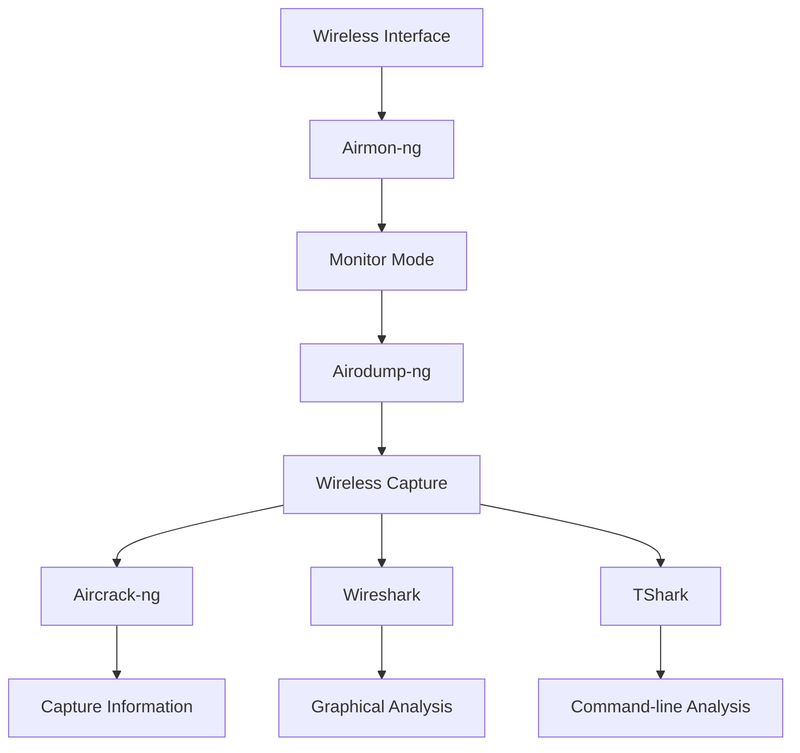
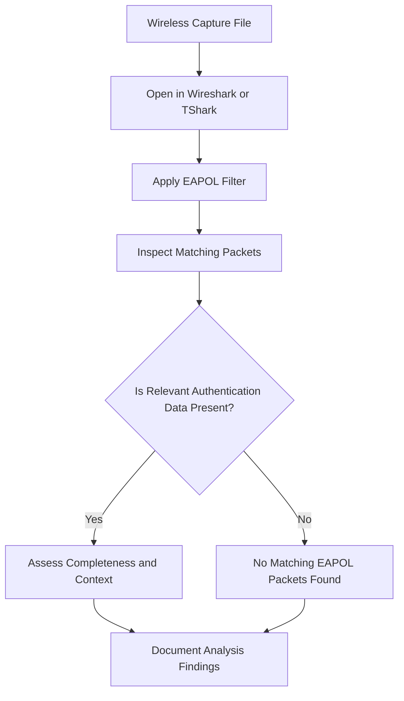

 <div align="center">

# 📡 Wireless Security & Capture Analysis

### Wireless Reconnaissance • Monitor Mode • Packet Capture • Authentication Analysis


</div>

---

> [!WARNING]
> **Authorized testing only.** Perform wireless discovery and capture analysis exclusively on networks you own or have explicit permission to assess. Do not capture or inspect other people's wireless communications without authorization.

## 📑 Table of Contents

- [1. Overview](#-1-overview)
- [2. Tools Explored](#-2-tools-explored)
- [3. Wireless Interface Inspection](#-3-wireless-interface-inspection)
- [4. Monitor Mode](#-4-monitor-mode)
- [5. Wireless Network Observation](#-5-wireless-network-observation)
- [6. Wireless Capture Inspection](#-6-wireless-capture-inspection)
- [7. EAPOL Packet Analysis](#-7-eapol-packet-analysis)
- [8. Understanding Capture Limitations](#-8-understanding-capture-limitations)
- [9. Technical Concepts Learned](#-9-technical-concepts-learned)
- [10. Security Lessons](#-10-security-lessons)
- [11. Practical Assessment Checklist](#-11-practical-assessment-checklist)
- [12. References](#-12-references)

---

## 🔍 1. Overview

Wireless security exercises provide practical insight into Wi-Fi discovery, wireless interface operation, authentication traffic, and packet-capture analysis.

This documentation focuses on understanding how wireless security tools interact with supported wireless hardware and how captured traffic can be inspected using command-line and graphical analysis tools.

### Main Learning Areas

| Area | Description |
|---|---|
| Wireless discovery | Observing nearby access points in an authorized environment |
| Interface management | Inspecting wireless interfaces and their operating modes |
| Monitor mode | Understanding passive wireless observation |
| Packet capture | Working with wireless capture files |
| Authentication analysis | Identifying EAPOL traffic |
| Capture validation | Understanding the limitations of captured data |

## 🛠️ 2. Tools Explored

| Tool | Primary Function |
|---|---|
| **Aircrack-ng** | Inspects compatible wireless captures and reports authentication-related information |
| **Airmon-ng** | Manages monitor mode on supported wireless interfaces |
| **Airodump-ng** | Observes access points and wireless traffic |
| **Wireshark** | Provides graphical packet inspection and analysis |
| **TShark** | Provides command-line packet analysis |

### Tool Relationship



## 🔌 3. Wireless Interface Inspection

Before performing wireless analysis, it is important to identify the available wireless interfaces.

### Command

```bash
iw dev
```

### Purpose

The command displays wireless devices and their associated interface information.

Important details include:

- Wireless interface name
- Interface type
- Associated wireless PHY device
- Current operating configuration

### Why Interface Identification Matters

Wireless tools require the correct interface name. Interface names vary depending on the hardware, Linux distribution, driver, and system configuration.

> [!TIP]
> Always inspect the available interfaces before using a wireless security tool. Never assume that an interface has a particular name.

## 📶 4. Monitor Mode

### What Is Monitor Mode?

Monitor mode is a wireless interface operating mode that allows compatible hardware to receive and observe wireless frames without operating as a normal connected Wi-Fi client.

It is commonly used in authorized wireless monitoring and packet-analysis exercises.

### Managed Mode vs Monitor Mode

| Feature | Managed Mode | Monitor Mode |
|---|---|---|
| Main purpose | Connect to a wireless network | Observe wireless frames |
| Normal Wi-Fi connection | Supported | Not its primary purpose |
| Wireless observation | Limited by normal operation | Designed for frame observation |
| Typical use | Everyday connectivity | Wireless analysis |

### Starting Monitor Mode

On supported hardware:

```bash
sudo airmon-ng start <WIRELESS_INTERFACE>
```

The resulting monitor interface name depends on the wireless hardware and driver.

### Important Considerations

- Not every wireless adapter supports monitor mode.
- Driver compatibility affects available functionality.
- Interface names may change when monitor mode is enabled.
- Some adapters have limitations when capturing specific wireless traffic.

## 📡 5. Wireless Network Observation

Airodump-ng is used to observe wireless access points and traffic in an authorized testing environment.

### Command

```bash
sudo airodump-ng <MONITOR_INTERFACE>
```

### Understanding the Output

| Field | Meaning |
|---|---|
| **BSSID** | Access point's Basic Service Set Identifier |
| **PWR** | Signal-strength indication reported by the tool |
| **CH** | Wireless channel |
| **ENC** | Encryption information |
| **AUTH** | Authentication information |
| **ESSID** | Wireless network name, when available |

### Why These Fields Matter

- **BSSID:** Helps distinguish individual access points.
- **PWR:** Provides an indication of received signal strength.
- **CH:** Identifies the channel on which an access point operates.
- **ENC:** Provides information about the advertised encryption configuration.
- **AUTH:** Indicates authentication-related information.
- **ESSID:** Identifies the network name when it is broadcast or otherwise available.

> [!NOTE]
> Observing an access point does not establish permission to interact with it. Discovery and testing are separate activities.

## 📁 6. Wireless Capture Inspection

Wireless packet captures can contain useful information for understanding network activity and authentication exchanges.

Aircrack-ng can inspect compatible capture files and report information about detected wireless networks and authentication data.

### Capture Inspection Command

```bash
aircrack-ng scan-01.cap
```

### What This Command Does

The command examines the supplied capture file and attempts to identify relevant wireless network and authentication information.

The result depends on:

- Capture-file compatibility
- Available packet data
- Whether relevant authentication traffic was recorded
- Capture completeness

### Important Distinction

A capture file is not the same thing as a password list.

| Input | Purpose |
|---|---|
| `.cap` file | Contains captured wireless traffic |
| Wordlist | Contains candidate passwords used in authorized password-auditing workflows |

These are separate inputs with different purposes.

## 🔐 7. EAPOL Packet Analysis

### What Is EAPOL?

EAPOL stands for **Extensible Authentication Protocol over LAN**.

It is a protocol used to carry authentication-related information over LAN technologies, including wireless networks.

In WPA/WPA2-Personal authentication analysis, EAPOL frames are relevant to examining the four-way handshake.

### TShark Analysis

To identify EAPOL packets in a compatible capture:

```bash
tshark -r scan-01.cap -Y eapol
```

**Command breakdown:**

| Option | Meaning |
|---|---|
| `-r` | Reads packets from an existing capture file |
| `scan-01.cap` | Capture file being inspected |
| `-Y` | Applies a Wireshark display filter |
| `eapol` | Selects packets identified as EAPOL |

### Wireshark Analysis

Use this display filter:

```text
eapol
```

This displays packets matching the EAPOL protocol.

### Analysis Workflow



### Important Interpretation

Finding EAPOL packets does not automatically prove that a complete, usable handshake exists.

Packet presence and capture completeness are different concepts.

## 🧠 8. Understanding Capture Limitations

Packet-capture analysis depends on the information actually recorded.

A capture may be incomplete or unsuitable for a particular analysis task.

### Common Limitations

| Limitation | Explanation |
|---|---|
| Missing packets | Relevant frames may not have been captured |
| Incomplete exchange | Only part of an authentication exchange may be present |
| Unsupported hardware | The adapter may not capture the required traffic |
| Driver limitations | Driver behavior can affect capture quality |
| Channel mismatch | The interface may not be observing the relevant channel |
| Capture compatibility | Some tools may not support a particular capture format or content |

### Key Technical Principle

> A packet capture represents the traffic recorded by the capture system, not every packet transmitted across the wireless network.

This is important when interpreting results and writing security assessment reports.

## 🎓 9. Technical Concepts Learned

The following concepts summarize the knowledge developed through wireless security study.

| Concept | Technical Understanding |
|---|---|
| Wireless interface | The hardware/software interface used for wireless communication |
| Monitor mode | An operating mode designed for wireless frame observation |
| BSSID | Identifier associated with a wireless access point |
| ESSID | Wireless network name |
| Wireless channel | Radio-frequency channel used by a wireless network |
| EAPOL | Protocol used to transport authentication-related information |
| Packet capture | Recorded network traffic stored for later analysis |
| Capture completeness | Whether the recorded traffic contains sufficient information for a particular analysis |

## 🛡️ 10. Security Lessons

Wireless security analysis demonstrates several important principles:

1. **Hardware matters:** Wireless security tools depend on adapter and driver capabilities.
2. **Capture quality matters:** Missing packets can make an analysis incomplete.
3. **Protocol identification matters:** Filters such as `eapol` help isolate relevant authentication traffic.
4. **Evidence matters:** A tool's output should be interpreted in the context of the actual packets recorded.
5. **Authorization matters:** Wireless testing must be limited to networks within an approved scope.
6. **Documentation matters:** Findings should distinguish observed evidence from assumptions.

## ✅ 11. Practical Assessment Checklist

Use this checklist to document an authorized wireless analysis exercise.

- [ ] Identify the wireless interface.
- [ ] Confirm adapter and driver compatibility.
- [ ] Understand the difference between managed and monitor modes.
- [ ] Identify the available wireless observation interface.
- [ ] Observe authorized wireless access points.
- [ ] Understand BSSID, ESSID, channel, encryption, and authentication fields.
- [ ] Inspect a compatible wireless capture file.
- [ ] Apply the EAPOL display filter.
- [ ] Evaluate whether the captured authentication traffic is complete.
- [ ] Document limitations and findings.
- [ ] Confirm that the assessment remained within its authorized scope.

### Practical Status

| Activity | Status |
|---|---|
| Wireless security concepts | Studied |
| Tool functionality | Explored |
| Interface inspection | Command documented |
| Monitor mode | Command documented |
| Wireless observation | Command documented |
| Capture inspection | Command documented |
| EAPOL filtering | Command documented |
| Independent verification | Record only after completing and documenting the exercise |

> [!IMPORTANT]
> This documentation describes the tools, commands, and concepts. It does not claim that every exercise was successfully completed or that a complete authentication capture was obtained.

## 📚 12. References

- [Aircrack-ng Official Documentation](https://www.aircrack-ng.org/documentation.html)
- [Aircrack-ng Project](https://www.aircrack-ng.org/)
- [Wireshark Documentation](https://www.wireshark.org/docs/)
- [TShark Manual](https://www.wireshark.org/docs/man-pages/tshark.html)
- [Linux Wireless Documentation](https://wireless.docs.kernel.org/)

---

<div align="center">

### 📡 Wireless Security • Capture Analysis • Technical Learning

*Understand the traffic. Analyze the evidence. Respect the scope.*

**Authorized testing only.**

</div>
